# Barangay Admin & Staff Dashboard Redesign Plan
*(`http://{barangay}.lvh.me:3000/admin/dashboard`)*

## 1. Overview & Objectives

The **Barangay Admin & Health Staff Portal** (`/admin/*` on `http://{barangay}.lvh.me:3000`) is the daily clinical and operational workspace for **Barangay Admins (`role: :admin`)** and **Barangay Health Workers (`role: :staff`)**.

While the SuperAdmin Portal focuses on platform-wide governance, the **Barangay Admin Dashboard** is a **Clinic Operations & Patient Queue Command Center** used to:
1. Manage **Today's Clinic Schedule** (patients arriving for scheduled consultations, immunizations, and check-ups).
2. Review and approve/reject **Pending Patient Appointment Requests** (with live slot capacity awareness).
3. Monitor **Active Service Announcements** (capacity fill rate) and **Upcoming Community Health Events**.
4. Track **Health Program distribution** and weekly consultation trends.
5. Quickly publish new announcements, schedule events, onboard staff, or export PDF attendance reports.

---

## 2. Audit of Current Implementation & Bugs Found

| Area | Current File(s) | Issues & Limitations Identified |
| :--- | :--- | :--- |
| **App Shell & Sidebar** | [`layouts/admin.html.erb`](../../../app/views/layouts/admin.html.erb)<br>[`admin/shared/_sidebar.html.erb`](../../../app/views/admin/shared/_sidebar.html.erb) | - Uses generic public `shared/_navbar.html.erb` instead of a dedicated Admin Topbar.<br>- Sidebar has a **dead `#` link for "Subdivisions"** (`<a href="#" class="nav-link text-white">Subdivisions</a>`) with no controller route.<br>- Does not display which **Barangay Tenant** (`ActsAsTenant.current_tenant.name`) the user is currently managing.<br>- Lacks live badge counters for *Pending Appointments* or *Today's Schedule*. |
| **Today's Appointments Query Bug** | [`Admin::DashboardController`](../../../app/controllers/admin/dashboard_controller.rb#L3) | - `@today_appointments_count = Appointment.where("DATE(created_at) = ?", Date.today).count` counts appointments **created** today rather than appointments **scheduled for today** (`scheduled_at: Time.current.all_day`). |
| **Bootstrap 4 Legacy Classes** | [`admin/dashboard/index.html.erb`](../../../app/views/admin/dashboard/index.html.erb) | - Uses deprecated Bootstrap 4 classes (`border-left-primary`, `no-gutters`, `font-weight-bold`, `mr-2`) that have no effect in Bootstrap 5, leaving cards without their colored left borders or proper font weights. |
| **Lack of Clinical Queues** | [`admin/dashboard/index.html.erb`](../../../app/views/admin/dashboard/index.html.erb) | - Only shows 4 static numbers and 2 charts.<br>- Health workers logging in at 8:00 AM cannot see **who is scheduled for today** or **which bookings are waiting for approval** without navigating away and manually filtering `/admin/appointments`. |

---

## 3. Visual Design System & Tenant Branding

The Barangay Admin Portal shares the **Modern Healthcare SaaS** design system with the SuperAdmin Portal, tailored for daily clinical workflows:

- **Sidebar Surface:** Deep Teal-Slate (`#0f172a` → `#064e3b` subtle accent) featuring a **Tenant Context Card** (`Brgy. Lao Health Center · lao.lvh.me`) so admins and staff always have clear visual confirmation of their active barangay tenant.
- **Primary Brand Accent:** Healthcare Emerald (`#059669`) & Clinical Teal (`#0d9488`).
- **Semantic Clinical Badges:**
  - `Pending Approval` — Soft Amber (`#fffbeb` / `#b45309`)
  - `Approved / Scheduled` — Soft Sky (`#f0f9ff` / `#0284c7`)
  - `Completed (With Clinical Notes)` — Soft Emerald (`#ecfdf5` / `#059669`)
  - `Waitlisted` — Soft Purple (`#f5f3ff` / `#6d28d9`)
  - `Cancelled / Rejected / Missed` — Soft Rose (`#fff1f2` / `#e11d48`)

---

## 4. Layout & Component Architecture

```mermaid
flowchart TD
    subgraph AdminShell["Barangay Admin App Shell (layouts/admin.html.erb)"]
        direction LR
        subgraph Sidebar["Collapsible Clinical Sidebar (admin/shared/_sidebar.html.erb)"]
            TenantBadge["Barangay Health Center Brand\n+ Active Tenant Pill (e.g. Brgy. Lao)"]
            NavClinic["CLINICAL OPERATIONS\n• Dashboard\n• Appointments (Pending Badge)\n• Announcements & Slots\n• Health Programs\n• Community Events"]
            NavAdmin["BARANGAY ADMINISTRATION\n• Residents & Staff (Users)\n• Barangay CMS (Hero/About/Map)\n• Submit/Edit Platform Testimonial"]
            UserFooter["Sticky Footer: Admin/Staff Profile + Logout"]
            TenantBadge --> NavClinic --> NavAdmin --> UserFooter
        end

        subgraph MainContent["Fluid Main Content Area"]
            Topbar["Dedicated Admin Topbar (admin/shared/_topbar.html.erb)\nSidebar Toggle | Breadcrumb | Quick Create (+ Announcement, + Event, + Staff) | Public Portal Link | Notifications | Profile"]
            HeaderBar["Clinic Welcome Header & Quick Action Bar\nNew Announcement | New Event | Review Pending Bookings | Visit Barangay Subdomain"]
            KPIRow["Row 1: 4 Clinical KPI Cards\n1. Today's Clinic Schedule (Approved vs Completed today)\n2. Pending Appointment Approvals (Action Required + Waitlisted count)\n3. Registered Residents & Patients (Active patients + Purok/Zone count)\n4. Active Health Programs & Staff (Active Announcements + BHW count)"]
            QueueRow["Row 2: Live Clinical Queues (col-xl-7 + col-xl-5)\n• Left: Today's Scheduled Patients & Pending Approvals Queue (1-Click Approve / Complete / View)\n• Right: Active Announcements Capacity Progress Bars (Slots Booked vs Max Capacity + PDF Export)"]
            ChartsRow["Row 3: Consultation Analytics (col-xl-8 + col-xl-4)\n• Left: Weekly Appointments Trend by Announcement/Program\n• Right: Health Program Distribution (Donut Chart)"]

            Topbar --> HeaderBar --> KPIRow --> QueueRow --> ChartsRow
        end
    end
```



---

## 5. Detailed Component Specifications

### 5.1 App Shell (`layouts/admin.html.erb`, `_sidebar.html.erb`, `_topbar.html.erb`)
1. **Tenant Context Header in Sidebar:**
   - Displays `"Brgy. #{ActsAsTenant.current_tenant.name} Health Center"` and a role pill (`Admin` or `Health Staff`).
2. **Organized Sidebar Navigation (`app/views/admin/shared/_sidebar.html.erb`):**
   - **Clinical Operations:**
     - `bi-grid-1x2-fill` — **Dashboard** (`admin_dashboard_index_path`)
     - `bi-calendar2-check-fill` — **Appointments** (`admin_appointments_path`) with Amber badge for `@sidebar_pending_appointments_count`
     - `bi-megaphone-fill` — **Announcements** (`admin_announcements_path`)
     - `bi-heart-pulse-fill` — **Health Programs** (`admin_health_programs_path`)
     - `bi-calendar-event-fill` — **Community Events** (`admin_events_path`)
   - **Barangay Administration:**
     - `bi-people-fill` — **Users & Staff** (`admin_users_path`)
     - `bi-window-stack` — **Barangay CMS** (`admin_cms_path`)
     - `bi-chat-heart-fill` — **Leave Testimonial** (triggers `#testimonialModal` for Admin)
     - `bi-box-arrow-up-right` — **View Resident Portal** (`root_path`)
   - *Fix:* Removes the dead `Subdivisions` `#` link (or integrates Subdivision counts cleanly into the Users/Barangay info).
3. **Dedicated Admin Topbar (`app/views/admin/shared/_topbar.html.erb`):**
   - **Left:** Sidebar toggle button + Breadcrumb (`Brgy. Lao / Dashboard`).
   - **Right:**
     - **"+ Quick Create"** dropdown (`New Announcement`, `New Health Program`, `New Community Event`, `New Staff Account`).
     - **"Resident View"** button linking to `root_path` on the current subdomain.
     - Real-time Notification Bell (`shared/notification_parent`).
     - User Avatar & Profile dropdown.

---

### 5.2 Row 1: 4 Enhanced Clinical KPI Cards
Each KPI card links to its corresponding filtered page and uses Bootstrap 5 classes:

1. **Today's Clinic Schedule (`admin_appointments_path(q: { scheduled_at_gteq: Date.current.beginning_of_day })`)**
   - **Primary Metric:** `@today_scheduled_count` (Appointments scheduled for today)
   - **Sub-metrics:** `X Completed` · `Y Remaining today`
   - **Icon:** `bi-calendar-check` (Emerald icon well)
2. **Pending Approvals (`admin_appointments_path(q: { status_eq: 0 })`)**
   - **Primary Metric:** `@pending_appointments_count`
   - **Sub-metrics:** Highlighted in Amber when `> 0` (*"Needs review"*), plus `@waitlisted_appointments_count` waitlisted
   - **Icon:** `bi-hourglass-split` (Amber icon well)
3. **Registered Residents (`admin_users_path(role: 'patient')`)**
   - **Primary Metric:** `@total_patients`
   - **Sub-metrics:** Across `@subdivisions_count` Puroks/Zones · `+@new_patients_this_month` this month
   - **Icon:** `bi-people` (Sky icon well)
4. **Programs & Health Workers (`admin_health_programs_path`)**
   - **Primary Metric:** `@total_health_programs` Active Programs
   - **Sub-metrics:** `@active_announcements_count` Active Announcements · `@total_health_workers` Health Staff
   - **Icon:** `bi-heart-pulse` (Teal icon well)

---

### 5.3 Row 2: Live Clinical Queues

#### Left (`col-12 col-xl-7`): Tabbed Appointment Queue
Provides instant access to the two most time-sensitive lists without leaving the dashboard:
- **Tab 1: Pending Approval (`@pending_appointments`, limit 5)**
  - Shows Patient Name & Avatar, Announcement/Service Name, Requested Schedule Date/Time, Slot Capacity Pill (`45/100`), and 1-click **Approve** (`PATCH flag_as_approved_admin_appointment_path`) / **Reject** / **Inspect** buttons.
- **Tab 2: Today's Scheduled Patients (`@today_appointments`, limit 5)**
  - Shows patients scheduled for today (`approved` / `completed`), their Purok/Subdivision, reason for visit, status badge, and quick **View / Complete Consultation** link (`admin_appointment_path(appointment.public_uid)`).

#### Right (`col-12 col-xl-5`): Active Service Announcements & Capacity Monitor
- Lists currently active `Announcement` records (`@active_announcements`, limit 4) with:
  - Announcement Title & Health Program badge
  - Schedule window (`Start Date – End Date`, `Open – Close Time`)
  - **Visual Capacity Progress Bar** (`approved_patients_count / max_patients`, e.g., `78/100 booked — 78%`)
  - Quick links to **Manage Slots** (`appointment_details_admin_announcement_path`) and **Export PDF** (`admin_announcement_appointment_reports_path(format: :pdf)`).

---

### 5.4 Row 3: Consultation Analytics
- **Left (`col-12 col-xl-8`): Weekly Appointments Overview**
  - Chartkick `line_chart @line_chart_data` showing weekly appointment volume grouped by announcement/service.
- **Right (`col-12 col-xl-4`): Health Program Distribution**
  - Chartkick `pie_chart @pie_data, donut: true` showing announcement distribution across active Health Programs.

---

## 6. Controller Updates (`AdminController` & `Admin::DashboardController`)

```ruby
# app/controllers/admin_controller.rb
class AdminController < ApplicationController
  layout "admin"
  before_action :authenticate_user!
  before_action :authenticate_user_role
  before_action :generate_testimonial
  before_action :set_admin_sidebar_counts

  private

  def set_admin_sidebar_counts
    @sidebar_pending_appointments_count = Appointment.pending.count
    @sidebar_today_appointments_count = Appointment.where(scheduled_at: Time.current.all_day, status: [:approved, :completed]).count
  end
  # ...
end
```

```ruby
# app/controllers/admin/dashboard_controller.rb
class Admin::DashboardController < AdminController
  def index
    # 1. Fixed Today's Schedule & KPI Counts
    @today_appointments_count = Appointment.where(scheduled_at: Time.current.all_day).count
    @today_completed_count = Appointment.where(scheduled_at: Time.current.all_day, status: :completed).count
    @pending_appointments_count = @sidebar_pending_appointments_count
    @waitlisted_appointments_count = Appointment.tagged_with("waitlisted").count

    @total_patients = User.patient.count
    @subdivisions_count = Subdivision.count
    @total_health_programs = HealthProgram.active.count
    @active_announcements_count = Announcement.approved.count
    @total_health_workers = ActsAsTenant.current_tenant.admin_and_staff.count

    # 2. Live Clinical Queues
    @pending_appointments = Appointment.includes(:patient, :announcement)
                                       .pending
                                       .order(scheduled_at: :asc)
                                       .limit(5)

    @today_appointments = Appointment.includes(:patient, :announcement, :health_worker)
                                     .where(scheduled_at: Time.current.all_day)
                                     .order(scheduled_at: :asc)
                                     .limit(5)

    @active_announcements = Announcement.includes(:health_program)
                                        .where(status: :approved)
                                        .order(start_date: :asc)
                                        .limit(4)

    # 3. Charts
    @line_chart_data = Appointment.joins(:announcement).group("announcements.name").group_by_week(:created_at).count
    @pie_data = HealthProgram.active.left_joins(:announcements).group("health_programs.name").count("announcements.id")
  end
end
```

---

## 7. Interactive Prototype

Open the standalone interactive HTML prototype for the Barangay Admin Dashboard at:
- [`doc/design/admin/admin_dashboard_prototype.html`](./admin_dashboard_prototype.html)
