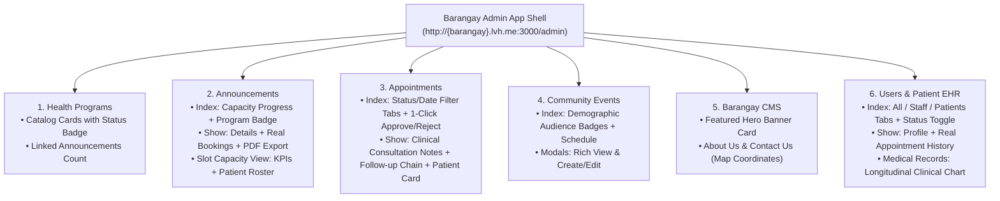

# Barangay Admin & Health Staff Portal Pages Redesign Plan
*(`http://{barangay}.lvh.me:3000/admin/*` — Announcements, Health Programs, Appointments, Events, CMS, Users & Medical Records)*

## 1. Executive Summary

This document specifies the comprehensive UI/UX and code redesign for all operational and clinical pages inside the **Barangay Admin & Health Staff Portal** (`/admin/*` on `http://{barangay}.lvh.me:3000`):

1. **Announcements & Slot Capacity Manager** (`/admin/announcements`, `/admin/announcements/:id`, `/admin/announcements/:id/appointment_details`)
2. **Health Programs Catalog** (`/admin/health_programs`, `/admin/health_programs/:id`)
3. **Appointments & Clinical Consultation Workflow** (`/admin/appointments`, `/admin/appointments/:id`)
4. **Community Health Events** (`/admin/events`)
5. **Barangay Portal CMS** (`/admin/cms`)
6. **Users, Health Staff & Patient Medical Records (EHR)** (`/admin/users`, `/admin/users/:id`, `/admin/users/:id/medical_records`)

---

## 2. Architecture & Clinical Workflow Map

---

## 3. Module-by-Module Audit & Redesign Specification

### 3.1 Announcements & Slot Capacity (`/admin/announcements`)

#### Current Pain Points ([`announcements/index.html.erb`](../../../app/views/admin/announcements/index.html.erb), [`show.html.erb`](../../../app/views/admin/announcements/show.html.erb), [`appointment_details.html.erb`](../../../app/views/admin/announcements/appointment_details.html.erb))
1. **Boxy Unstyled Table Card:** `index.html.erb` uses `.rounded-0` and places the *"New Announcement"* button inside the table card body instead of a proper page header.
2. **Missing Health Program & Capacity Columns:** The index table does not show which `HealthProgram` the announcement belongs to, nor does it show `approved_patients_count / max_patients` capacity.
3. **Hardcoded Fake Activity Log in `show.html.erb`:** Lines 186–234 of [`admin/announcements/show.html.erb`](../../../app/views/admin/announcements/show.html.erb#L186-L234) render hardcoded dummy strings (*"Juan Dela Cruz — Today, 08:30 AM"*, *"Maria Santos — Yesterday, 03:45 PM"*, *"May 15, 10:45 AM"*).
4. **Mixed Icon Libraries & Bootstrap 4 Classes in `appointment_details.html.erb`:** Uses FontAwesome classes (`fas fa-info-circle`, `fas fa-users`) alongside Bootstrap Icons (`bi-*`) and deprecated `.no-gutters`.

#### Redesign Specification
- **Announcements Index (`admin/announcements/index.html.erb`):**
  - **Page Header:** Title *"Service Announcements & Schedules"*, subtitle, Status Filter Pills (*All*, *Approved / Active*, *Pending*, *Completed*, *Archived*), and primary Emerald **"+ New Announcement"** button.
  - **Unified Search & Filter Bar:** Search by announcement title (`name_cont`), filter by `HealthProgram` (`health_program_id_eq`), Status (`status_eq`), and Date Range.
  - **Enhanced Table Columns:**
    1. **UID & Announcement Title** + linked `HealthProgram` badge.
    2. **Schedule Window:** Start – End dates + Daily operating hours (`8:00 AM – 5:00 PM`).
    3. **Slot Capacity:** Compact progress bar + `42 / 100 booked` badge.
    4. **Target Audience:** Demographic pills (`All Residents`, `Senior Citizens`, etc.).
    5. **Status:** Soft semantic badge (`Approved`, `Pending`, `Completed`, `Archived`).
    6. **Actions:** Direct **View**, **Slots (`appointment_details`)**, **PDF Report**, **Edit**, and **Archive** buttons.
- **Announcement Show (`admin/announcements/show.html.erb`):**
  - Replace the **fake hardcoded Activity Log** with a **Live Capacity & Recent Bookings Summary Card** showing real `@announcement.appointments.includes(:patient).order(created_at: :desc).limit(5)` and a visual capacity meter.
  - Clean two-column layout: Left (`col-lg-8`) for Media Gallery, Rich Description, and Schedule/Location/Audience details; Right (`col-lg-4`) for Quick Actions (*Edit*, *Download PDF Report*, *View Booked Patients*, *Public Page*, *Archive*), Capacity Meter, and Real Metadata.
- **Announcement Slot Capacity (`admin/announcements/appointment_details.html.erb`):**
  - Replace `fas fa-*` with Bootstrap Icons (`bi-*`) and Bootstrap 5 grid classes.
  - Display 4 clean KPI cards (*Scheduled Today*, *Available Slots Remaining*, *Pending Approvals*, *Cancelled/Rejected*) + interactive capacity progress bar + filtered patient table.

---

### 3.2 Health Programs Catalog (`/admin/health_programs`)

#### Current Pain Points ([`health_programs/index.html.erb`](../../../app/views/admin/health_programs/index.html.erb), [`show.html.erb`](../../../app/views/admin/health_programs/show.html.erb))
1. **Bare Cards:** Cards only show `name` and truncated `description`—missing `status` badge (`active`, `inactive`, `archived`), count of linked `announcements`, and quick Edit action.
2. **Inconsistent Container:** Wrapped in `
` with no page header title.

#### Redesign Specification
- **Header Bar:** Title *"Health Programs Catalog"*, subtitle, search bar, and **"+ New Health Program"** button.
- **Program Cards Grid (`row g-3`):**
  - Each card features a `bi-heart-pulse` Emerald icon well, Program Status badge (`Active` / `Archived`), Program Title, Description excerpt, count of linked Announcements (`X service schedules`), and footer actions (**View Program**, **Edit Modal**).
- **Program Show Page (`admin/health_programs/show.html.erb`):**
  - Displays program overview header, edit/delete actions, and a table of all `Announcement`s published under this Health Program.

---

### 3.3 Appointments & Clinical Consultation Workflow (`/admin/appointments`)

#### Current Pain Points ([`appointments/index.html.erb`](../../../app/views/admin/appointments/index.html.erb), [`_list_appointment_table.html.erb`](../../../app/views/admin/appointments/_list_appointment_table.html.erb), [`show.html.erb`](../../../app/views/admin/appointments/show.html.erb))
1. **No Quick Status Tabs on Index:** Health workers must open a filter form to switch between *Pending*, *Today's Schedule*, *Approved*, *Completed*, or *Cancelled*.
2. **Missing Flags & Health Worker Column in Table:** Waitlisted (`"waitlisted"`), Rescheduled (`"rescheduled"`), and Follow-Up (`"follow_up_check_up"`) flags are hidden from the table view.
3. **Hardcoded Fake Activity Log & Broken Profile Link in `show.html.erb`:**
   - Lines 100–146 of [`admin/appointments/show.html.erb`](../../../app/views/admin/appointments/show.html.erb#L100-L146) show hardcoded 2023 dummy entries (*"Changed from: November 14, 2023 3:00 PM"*, *"Assigned to: Dr. Maria Santos"*).
   - Line 240 has `<%= link_to "View Full Profile", "#" %>` instead of linking to `admin_user_path(@appointment.patient.public_uid)` and `medical_records_admin_user_path(@appointment.patient.public_uid)`.

#### Redesign Specification
- **Appointments Index (`admin/appointments/index.html.erb`):**
  - **Header & Segmented Tabs:** **All**, **Pending Approval**, **Scheduled Today**, **Approved**, **Waitlisted**, **Completed**, **Cancelled / Missed**.
  - **Table Enhancements (`_list_appointment_table.html.erb`):**
    - Shows `#public_uid`, **Patient Name & Avatar**, **Announcement & Reason**, **Scheduled Date/Time**, **Status + Flag Badges (`Waitlisted`, `Rescheduled`, `Follow-Up`)**, **Assigned Health Worker**, and **Quick Actions** (inline **Approve** / **Reject** buttons for pending bookings + **Clinical View** button).
- **Appointment Clinical Show View (`admin/appointments/show.html.erb`):**
  - **Clinical Workflow Action Bar:** Prominent status-driven actions:
    - If `pending`: **Approve Booking** (with live capacity badge) & **Reject**.
    - If `approved`: **Complete Consultation & Record Clinical Notes** (`#completed_modal`), **Reschedule**, or **Cancel**.
    - If `completed`: **Schedule Follow-Up Check-Up** (`#follow_up_modal`) or link to chained **Previous / Next Follow-Up Appointment**.
  - **Consultation Notes & Clinical Summary Card:** Clearly separates *Reason for Visit*, *Clinical Consultation Notes (`@appointment.notes`)*, and *Reschedule/Cancel Reasons*.
  - **Replace Fake Activity Log with Real Patient Consultation History / Follow-up Chain:** Shows actual timestamps (`created_at`, `scheduled_at`, `updated_at`, assigned `health_worker`) and links to any parent/child follow-up appointments.
  - **Fixed Patient Sidebar Card:** Links directly to `admin_user_path(@appointment.patient.public_uid)` and **Patient Medical Records (`medical_records_admin_user_path`)**.

---

### 3.4 Community Health Events (`/admin/events`)

#### Current Pain Points ([`events/index.html.erb`](../../../app/views/admin/events/index.html.erb))
1. **Missing Location & Target Audience Columns:** `Event` has `location` and `audience` (targeted demographic groups), which are not shown in the table.
2. **Boxy Card Layout:** Uses `.rounded-0` with no page title header.

#### Redesign Specification
- **Header & Status Tabs:** Title *"Community Health Events"*, status pills (*All*, *Upcoming*, *Ongoing*, *Completed*, *Archived*), and **"+ New Event"** button.
- **Enhanced Table:** Displays `#public_uid`, **Event Name**, **Location (`bi-geo-alt`)**, **Schedule (`start_date – end_date`)**, **Target Audience Pills**, **Status Badge**, and **View / Edit / Archive** actions.

---

### 3.5 Barangay Portal CMS (`/admin/cms`)

#### Current Pain Points ([`admin/cms/index.html.erb`](../../../app/views/admin/cms/index.html.erb))
1. Uses cramped `18rem` cards with `"Image Not Applicable"` placeholders for *About Us* and *Contact Us*.

#### Redesign Specification
- **Header Bar:** Title *"Barangay Portal CMS (`{barangay}.lvh.me`)"* + **"Preview Resident Portal"** button.
- **Featured Hero Banner Card (`col-12`):** Wide split card displaying the Barangay's custom hero banner image, headline, subheadline, and **Edit Hero Banner** modal trigger.
- **About Us & Contact Us Cards (`col-md-6`):** Clean structured cards showing the *About Us* rich-text summary and *Contact Us* details (with interactive Leaflet map coordinates badge `latitude, longitude`), **View Live Page**, and **Edit Section** button.

---

### 3.6 Users, Health Staff & Patient Medical Records (`/admin/users`)

#### Current Pain Points ([`users/index.html.erb`](../../../app/views/admin/users/index.html.erb), [`show.html.erb`](../../../app/views/admin/users/show.html.erb), [`medical_records.html.erb`](../../../app/views/admin/users/medical_records.html.erb))
1. **Misleading Page Title:** `users/index.html.erb` says `"Staff Users"` / `"Admin Staff Users"` even though `@staff_users` lists **all users in the barangay (both Patients and Staff/Admins)**.
2. **Hardcoded Fake Activity Log in `users/show.html.erb`:** Lines 62–78 of [`admin/users/show.html.erb`](../../../app/views/admin/users/show.html.erb#L62-L78) display hardcoded dummy events (*"Profile updated — 2 hours ago"*, *"Password changed — 1 week ago"*).
3. **Medical Records Table Lacks Clinical Polish:** `medical_records.html.erb` shows raw database `appt.id` instead of clickable `appt.public_uid` links to `admin_appointment_path(appt.public_uid)`.

#### Redesign Specification
- **Users & Residents Directory (`admin/users/index.html.erb`):**
  - **Header & Role Filter Tabs:** Title *"Residents & Health Staff Directory"*, segmented tabs for **All Barangay Users**, **Patients / Residents (`role: :patient`)**, **Health Staff (`role: :staff`)**, and **Admins (`role: :admin`)**, plus **"+ New Staff Account"** modal button (for Admins).
  - **Table Columns:** **User (Avatar + Full Name + UID)**, **Email & Phone**, **Purok / Subdivision**, **Role Badge**, **Account Status (`Active` / `Inactive` + Toggle button)**, and **Actions** (**View Profile**, **Medical Records (EHR)**, **Edit**).
- **User Show Page (`admin/users/show.html.erb`):**
  - Replace the **fake hardcoded Activity Log** with the user's **Recent Appointments Table** (`@user.appointments.includes(:announcement, :health_worker).order(scheduled_at: :desc).limit(5)`).
- **Patient Medical Records / EHR View (`admin/users/medical_records.html.erb`):**
  - **Patient Clinical Header Banner:** Avatar, Full Name, Patient UID, Purok/Subdivision, Phone, Email, Total Completed Visits count, and Follow-Up count.
  - **Longitudinal Consultation History Table:** Clickable `#public_uid` linking to `admin_appointment_path`, Consultation Date/Time, Service/Announcement Name, Attending Health Worker, Chief Complaint / Reason, Clinical Notes (`notes`), Follow-Up Chain link, and Status badge.

---

## 4. File Change Matrix

| Module | Files to Modify / Create | Key Improvements |
| :--- | :--- | :--- |
| **App Shell & Dashboard** | `app/views/layouts/admin.html.erb` `app/views/admin/shared/_sidebar.html.erb` `app/views/admin/shared/_topbar.html.erb` (New) `app/controllers/admin_controller.rb` `app/controllers/admin/dashboard_controller.rb` `app/views/admin/dashboard/index.html.erb` | - Tenant-aware sidebar + dedicated Admin Topbar. - Fix `@today_appointments_count` query bug & Bootstrap 5 classes. - Add Pending & Today's Appointment queues + Capacity bars. |
| **Announcements** | `app/views/admin/announcements/index.html.erb` `app/views/admin/announcements/show.html.erb` `app/views/admin/announcements/appointment_details.html.erb` | - Add Capacity progress column & Program badge. - Replace fake Activity Log on `show` with real bookings & capacity meter. - Standardize Bootstrap Icons on `appointment_details`. |
| **Health Programs** | `app/views/admin/health_programs/index.html.erb` `app/views/admin/health_programs/show.html.erb` | - Redesigned Program cards with status badge, announcement count, and quick actions. |
| **Appointments** | `app/views/admin/appointments/index.html.erb` `app/views/admin/appointments/_list_appointment_table.html.erb` `app/views/admin/appointments/show.html.erb` | - Status filter tabs, Waitlisted/Rescheduled/Follow-Up flag badges. - Remove fake Activity Log on `show` and wire real Patient Profile & Medical Records links. |
| **Community Events** | `app/views/admin/events/index.html.erb` | - Add Location & Target Audience pills + clean header & status tabs. |
| **Barangay CMS** | `app/views/admin/cms/index.html.erb` | - Featured Hero Banner card + structured About Us & Contact Us cards. |
| **Users & EHR** | `app/views/admin/users/index.html.erb` `app/views/admin/users/show.html.erb` `app/views/admin/users/medical_records.html.erb` | - Role tabs (*All / Patients / Staff*), Purok column, real Appointment History on `show`, and EHR-style Medical Records chart. |

---

## 5. Interactive Prototypes

- **Barangay Admin Dashboard Prototype:** [`doc/design/admin/admin_dashboard_prototype.html`](./admin_dashboard_prototype.html)
- **All Barangay Admin Pages Prototype:** [`doc/design/admin/admin_pages_prototype.html`](./admin_pages_prototype.html)
