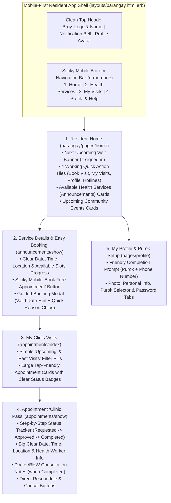

# Barangay Resident & Patient Portal Redesign Plan
*(`http://{barangay}.lvh.me:3000` — Mobile-First, Non-Tech Friendly UI/UX for Patients)*

## 1. Executive Summary & UX Philosophy

The **Barangay Resident / Patient Portal** (`Barangay::*` controllers on `http://{barangay}.lvh.me:3000`) is used by community residents—including **mothers, senior citizens, PWDs, and working families**—primarily on **mobile phones** over mobile data.

To make the experience effortless for non-technical users, this redesign applies five core UX principles:
1. **Mobile-First Navigation with Labeled Icons:** Replaces unlabeled `32x32px` icon circles with a **Sticky Mobile Bottom Tab Bar** (`Home`, `Services`, `My Visits`, `Profile`) and labeled desktop navigation buttons (`min-height: 48px` touch targets).
2. **Plain, Reassuring Language (No Tech Jargon):** Uses clear everyday terms (*"Book Free Check-Up"*, *"My Clinic Visits"*, *"Waiting for Health Center Approval"*) instead of system terms (*"Set Appointment"*, *"Flags"*, *"Public UID"*).
3. **Guided 2-Step Appointment Booking:** Displays available slot counts (`22 slots left`), pre-fills valid date/time boundaries (`min`/`max` from the announcement), and offers quick-tap reason chips (*"Vaccination"*, *"Prenatal Check-Up"*, *"Blood Pressure Check"*, *"General Consultation"*).
4. **Digital "Clinic Pass" Appointment View:** Formats a booked appointment like a clear mobile ticket showing **Status**, **What to Bring / When to Arrive**, **Date & Time**, **Location**, and big, unmistakable buttons for **Reschedule** or **Cancel**.
5. **Guided Profile Completion:** Prompts new residents to add their **Purok/Zone** and **Mobile Number** in one simple card rather than four disconnected forms.

---

## 2. Audit of Current Patient Pages & Bugs Found

| Page / Component | Current File(s) | Usability Issues & Bugs Found |
| :--- | :--- | :--- |
| **Mobile & Desktop Navbar** | [`shared/_navbar.html.erb`](../../../app/views/shared/_navbar.html.erb) [`layouts/barangay.html.erb`](../../../app/views/layouts/barangay.html.erb) | - Uses unlabeled `32x32px` circular icon buttons (`bi-house-door`, `bi-calendar-week`); non-tech users cannot tell that the calendar icon means *"My Appointments"*. - No bottom navigation bar on mobile phones. |
| **Resident Home Page** | [`barangay/pages/home.html.erb`](../../../app/views/barangay/pages/home.html.erb) | - **3 of 4 "Quick Links" are dead `href="#"` links!** (*Appointments*, *Medical Records*, and *Emergency Contact* all point to `#`). - Shows no personalized summary of the resident's **Next Upcoming Appointment** when signed in. |
| **Announcement Card** | [`barangay/announcements/_card.html.erb`](../../../app/views/barangay/announcements/_card.html.erb) | - **Time Display Bug (Line 33):** Prints `open_time - open_time` (`8:00 AM - 8:00 AM`) instead of `open_time - close_time`! - **Tailwind Class Mismatch:** Uses Tailwind classes (`grid grid-cols-2`, `flex items-center`, `mr-2`, `text-sm`) in a Bootstrap 5 project. - Does not show remaining slot capacity (`max_patients - approved_patients_count`). |
| **Announcement Detail & Booking Modal** | [`barangay/announcements/_announcement.html.erb`](../../../app/views/barangay/announcements/_announcement.html.erb) [`_appointment_form.html.erb`](../../../app/views/barangay/appointments/_appointment_form.html.erb) | - **Hidden CTA When Signed Out:** If a visitor is not logged in, the *"Set Appointment"* button vanishes completely (`if user_signed_in?`) without telling them to sign in to book. - **Unconstrained Date Picker:** `datetime_field :scheduled_at` does not display or enforce `announcement.start_date` to `end_date` in the UI, causing confusing validation errors. - Duplicate `900x600` images rendered in both main and thumbnail Splide sliders. |
| **My Appointments List** | [`barangay/appointments/index.html.erb`](../../../app/views/barangay/appointments/index.html.erb) | - **Dead "New Appointment" Button:** Top-right `<a href="#">New Appointment</a>` goes nowhere (`#`). - Cluttered 3-column row inside each list item that stacks awkwardly on narrow mobile screens. - No simple tabs for **Upcoming Visits** vs. **Past / Completed Visits**. |
| **Appointment Detail ("Clinic Pass")** | [`barangay/appointments/show.html.erb`](../../../app/views/barangay/appointments/show.html.erb) | - Hides **Reschedule** and **Cancel** inside an `"Actions"` dropdown menu at the top, while also duplicating a `"Reschedule"` button at the bottom. - Renders a disabled `"View Previous Appointment"` button even when `follow_up_id` is nil. - Prints raw developer array brackets in reminder alert: `"[24 hours, 1 hour, 30 minutes, 5 minutes]"`. |
| **Resident Profile Page** | [`barangay/pages/profile.html.erb`](../../../app/views/barangay/pages/profile.html.erb) [`partials/profile/*`](../../../app/views/barangay/partials/profile/_profile_form.html.erb) | - Uses a broken `.row.container-fluid` with four `col-md-5` boxes. - Doesn't highlight missing required info (`no_subdivision` / `no_phone_number` flags). |

---

## 3. Patient Journey & Mobile Architecture

---

## 4. Detailed Page-by-Page Redesign Specifications

### 4.1 Mobile-First Navigation (`layouts/barangay.html.erb` & `shared/_navbar.html.erb`)
- **Top Bar:**
  - Displays Barangay Logo + `"Brgy. #{ActsAsTenant.current_tenant.name} Health Center"`.
  - On Desktop (`d-none d-md-flex`): Clear text+icon links for **Home**, **Health Services**, **My Visits** (with count badge), **About Us**, **Contact & Map**, **Notifications**, and **Profile**.
- **Sticky Mobile Bottom Navigation Bar (`d-flex d-md-none fixed-bottom bg-white border-top shadow-lg`):**
  - 4 large (`56px` height) thumb-friendly tabs with icon + label:
    1. `bi-house-heart-fill` — **Home** (`root_path`)
    2. `bi-megaphone-fill` — **Services** (`root_path(anchor: "AnnouncementCarousel")`)
    3. `bi-calendar2-check-fill` — **My Visits** (`appointments_path`)
    4. `bi-person-circle` — **Profile** (`edit_profile_path(current_user)` or `new_user_session_path`)

---

### 4.2 Resident Home Page (`app/views/barangay/pages/home.html.erb`)
1. **Warm Community Hero Banner:**
   - Welcomes the resident by first name when signed in (*"Magandang araw, Juan! Welcome to Brgy. Lao Health Center"*).
   - Primary CTA: **"Book a Health Service"** (`#AnnouncementCarousel`) + Secondary CTA: **"My Scheduled Visits"** (`appointments_path`).
2. **"Your Next Clinic Visit" Alert Card (When Signed In & Has Upcoming Appointment):**
   - Immediately surfaces the resident's next `pending` or `approved` appointment right at the top of the home page with date, time, service name, status badge, and a 1-tap **"View Clinic Pass"** button.
3. **4 Working Quick-Action Tiles (Fixes the 3 dead `#` links!):**
   - **My Appointments** → `appointments_path`
   - **Book a Check-Up** → `#AnnouncementCarousel`
   - **My Purok & Profile** → `edit_profile_path(current_user)`
   - **Health Center Map & Hotlines** → `contact_us_pages_path`
4. **Available Health Services Cards (`barangay/announcements/_card.html.erb`):**
   - Fixes `open_time - close_time` bug and replaces non-existent Tailwind classes with clean Bootstrap 5 cards.
   - Displays **Health Program badge**, **Slots Available badge** (`22 slots open` in green, or `Waitlist Open` in amber if full), **Clear Date & Daily Hours**, **Location**, **Who Can Attend** (`All Residents`, `Senior Citizens`, etc.), and a full-width **"View & Book Slot →"** button.
5. **Upcoming Community Events Cards (`barangay/events/_card.html.erb`):**
   - Clean visual cards with Event Image, Target Demographic badge, Date, Location, and **"Read Event Details"** button.

---

### 4.3 Service Details & Foolproof Booking Modal (`_announcement.html.erb` & `_appointment_form.html.erb`)
1. **Clear Service Overview Card:**
   - Shows the service title, Health Program badge, and a 4-box visual summary grid with large icons:
     - **📅 Dates:** `Nov 2 – Nov 8, 2026`
     - **⏰ Clinic Hours:** `8:00 AM – 5:00 PM`
     - **📍 Location:** `Barangay Hall`
     - **👥 Slot Availability:** Progress bar + `22 of 100 slots remaining`
2. **Always-Visible Booking Call-to-Action (Sticky on Mobile):**
   - **If Signed In:** Large Emerald button **"Book My Appointment Slot"** opening the booking modal.
   - **If Signed Out (Fixes disappearing button!):** Large Emerald button **"Sign In to Book This Service"** (`new_user_session_path`) + link to **"Create Resident Account"** (`new_user_registration_path`).
3. **Guided Booking Modal (`_modal_form.html.erb` & `_appointment_form.html.erb`):**
   - **Schedule Helper Box:** Explicitly tells the resident: *"Please pick a date between **<%= announcement.start_date.strftime('%b %d') %>** and **<%= announcement.end_date.strftime('%b %d, %Y') %>** during clinic hours (**<%= announcement.open_time.strftime('%I:%M %p') %> – <%= announcement.close_time.strftime('%I:%M %p') %>**)."*
   - Sets HTML `min` and `max` attributes on `form.datetime_field :scheduled_at` so mobile native date pickers automatically block invalid dates.
   - **Quick-Tap Reason Chips:** Tappable pills (*"Vaccination / Booster"*, *"General Check-Up"*, *"Prenatal Visit"*, *"Blood Pressure Monitoring"*, *"Follow-Up"*) that populate the `reason` textarea with 1 tap for users who dislike typing on mobile.

---

### 4.4 My Appointments (`app/views/barangay/appointments/index.html.erb`)
- **Header & Working CTA:**
  - Title: **"My Clinic Visits & Appointments"**.
  - Replaces the dead `<a href="#">New Appointment</a>` with a working link to `root_path(anchor: "AnnouncementCarousel")` labeled **"+ Book New Visit"**.
- **Simple Filter Pills:**
  - **All Visits**, **Upcoming (`Pending` & `Approved`)**, **Completed**, **Cancelled**.
- **Mobile-Friendly Visit Cards (Replaces cramped 3-column list items):**
  - Each card clearly shows:
    - **Top Row:** Status Badge (`Waiting for Approval`, `Confirmed / Approved`, `Completed`, `Waitlisted`) + Visit Number `#public_uid`.
    - **Middle:** Service Name (`appointment.announcement.name`), large **Date & Time** (`Sunday, Nov 2, 2026 • 8:00 AM`), and **Location** (`Barangay Hall`).
    - **Bottom Row:** Attending Health Worker (or *"Assigned at Clinic"*) + **"View Clinic Pass →"** button.

---

### 4.5 Appointment "Clinic Pass" Detail View (`app/views/barangay/appointments/show.html.erb`)
- **Visual 3-Step Progress Tracker at Top:**
  - `1. Requested` ➔ `2. Approved by Health Center` ➔ `3. Visit Completed` (so non-tech patients immediately understand where their booking stands).
- **Digital "Clinic Pass" Card:**
  - Large, high-contrast Date & Time banner, Location with map pin icon, Assigned Health Worker, and Chief Reason.
  - **Doctor / Health Worker Notes Box (Highlighted when `completed`):** Clearly displays the clinical notes/instructions recorded by the health worker during the visit.
  - **Linked Follow-Up Card:** Only shown when `@appointment.follow_up_id.present?` (removes the confusing disabled button when there is no previous visit).
- **Friendly Reminder Banner (Fixes raw `[24 hours, ...]` brackets):**
  - *"We will send a reminder to your phone and email 24 hours, 1 hour, and 30 minutes before your check-up. Please arrive 15 minutes early."*
- **Direct, Unhidden Action Buttons (No Dropdown Needed):**
  - Large, clearly labeled buttons at the bottom of the pass:
    - **Reschedule Visit** (opens `#reschedule_modal`)
    - **Cancel Visit** (opens `#cancel_schedule_modal`)

---

### 4.6 Resident Profile & Purok Setup (`app/views/barangay/pages/profile.html.erb`)
- **Friendly Completion Banner (When `no_subdivision` or `no_phone_number` flag is present):**
  - Soft Amber callout at the top: *"Almost done! Please select your **Purok / Subdivision** and add your **Mobile Phone Number** so our Barangay Health Workers can assist you."*
- **Clean 2-Column / Mobile-Stacked Layout (Fixes broken `.row.container-fluid .col-md-5`):**
  1. **Photo & Personal Info Card (`col-12 col-lg-6`):** Profile photo preview + upload, First/Middle/Last Name, Suffix, and Phone Number.
  2. **Purok / Subdivision & Security Card (`col-12 col-lg-6`):** Purok selector (`@subdivisions`) and Password update form.

---

## 5. Implementation File Matrix

| Area | Files to Modify | Key Mobile & Non-Tech UX Changes |
| :--- | :--- | :--- |
| **App Shell & Mobile Nav** | `app/views/layouts/barangay.html.erb` `app/views/shared/_navbar.html.erb` | Add sticky mobile bottom navigation bar (`Home`, `Services`, `My Visits`, `Profile`) and text labels to top navbar icons. |
| **Resident Home** | `app/controllers/barangay/pages_controller.rb` `app/views/barangay/pages/home.html.erb` | Load `@next_appointment` for signed-in patient; fix all 3 dead `href="#"` Quick Links; add mobile-friendly service & event sections. |
| **Announcements & Booking** | `app/views/barangay/announcements/_card.html.erb` `app/views/barangay/announcements/_announcement.html.erb` `app/views/barangay/announcements/_modal_form.html.erb` `app/views/barangay/appointments/_appointment_form.html.erb` | Fix `open_time - close_time` bug; replace Tailwind classes with Bootstrap 5; show remaining slot count; show Sign-In CTA when logged out; add `min`/`max` date constraints & quick-tap reason chips in booking form. |
| **My Appointments & Clinic Pass** | `app/views/barangay/appointments/index.html.erb` `app/views/barangay/appointments/show.html.erb` | Fix dead *"New Appointment"* button; add *Upcoming / Past* filter pills; redesign `show` as a visual **Clinic Pass** with 3-step progress bar, direct Reschedule/Cancel buttons, and friendly reminder text. |
| **Resident Profile** | `app/views/barangay/pages/profile.html.erb` `app/views/barangay/partials/profile/*` | Add Purok/Phone completion banner and responsive `col-12 col-lg-6` card layout. |

---

## 6. Interactive Mobile & Desktop Prototype

Open the interactive HTML prototype (which includes a **📱 Mobile Phone (`390px`) vs. 💻 Desktop Viewport Toggle** at the top!) at:
- [`doc/design/patient/patient_pages_prototype.html`](./patient_pages_prototype.html)
