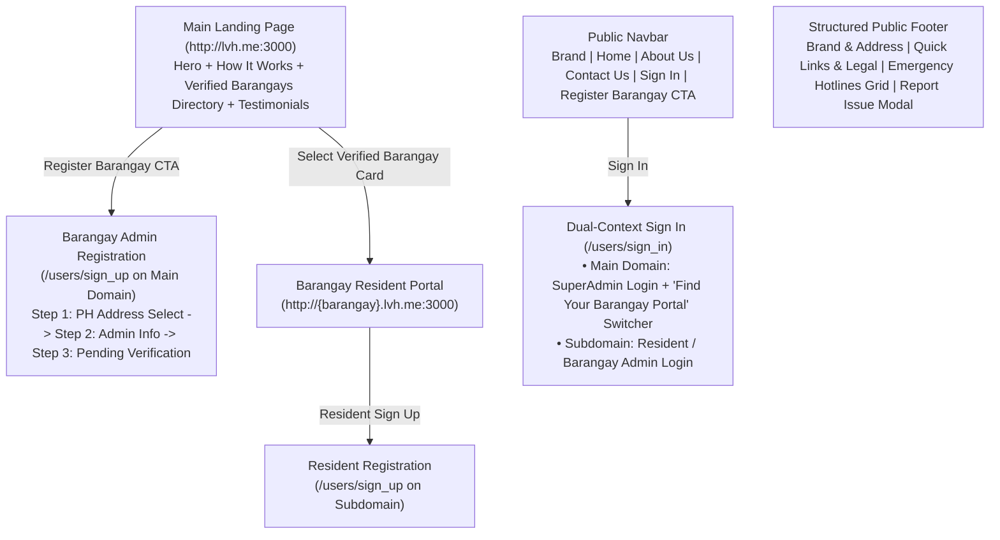

# Platform Public Pages & Authentication Suite Redesign Plan
*(`http://lvh.me:3000` — Landing Page, Public Navbar/Footer, About Us, Contact Us, Legal Pages, Sign In, Sign Up, Forgot Password & Issue Reporting)*

## 1. Overview & Objectives

The **Platform Public Pages** serve as the front door to the `brgy_health` SaaS ecosystem. They cater to two primary audiences:
1. **Barangay Officials & Health Center Administrators** visiting the main domain (`http://lvh.me:3000`) to learn about the platform and **register their Barangay** (`/users/sign_up`).
2. **Barangay Residents & Patients** looking to navigate to their **verified Barangay Health Portal** (`http://{barangay}.lvh.me:3000`), sign up or sign in, and access community health services.

---

## 2. Audit of Current Implementation & Bugs Found

| Page / Component | Current File(s) | Issues, Bugs & UX Gaps Identified |
| :--- | :--- | :--- |
| **Landing Page (`root_path`)** | [`PagesController#home`](../../../app/controllers/pages_controller.rb#L2-L6) [`pages/home.html.erb`](../../../app/views/pages/home.html.erb) | - **Unverified Barangay 404 Bug:** `@barangays = Barangay.all` includes unverified barangays whose links lead to a `404` page. Must scope to `Barangay.verified`. - **Broken Carousel Indicators:** Indicator buttons target `#carouselBarangayIndicators` and `#carouselTestimonialIndicators`, which do not match `id="carouselBarangay"` / `id="carouselTestimonial"`. - **Privacy Leak in Testimonials:** Displays `testimonial.user.email` publicly instead of their Barangay name and omits `testimonial.rating` stars. - **Missing SaaS Value Proposition:** No "How It Works", Feature Grid, or Hero CTA buttons (*"Register Your Barangay"*, *"Browse Barangays"*). |
| **Public Navbar & Footer** | [`shared/_navbar.html.erb`](../../../app/views/shared/_navbar.html.erb) [`shared/_footer.html.erb`](../../../app/views/shared/_footer.html.erb) | - Navbar uses grey `bg-dark-subtle` pills and lacks a **"Register Barangay"** button on the main domain. - Footer has unformatted stacked text, lacks structured columns, and crowds 8 emergency hotlines into a plain list. |
| **Static CMS Pages** | [`about_us.html.erb`](../../../app/views/pages/about_us.html.erb) [`contact_us.html.erb`](../../../app/views/pages/contact_us.html.erb) [`privacy_policy.html.erb`](../../../app/views/pages/privacy_policy.html.erb) [`terms_of_use.html.erb`](../../../app/views/pages/terms_of_use.html.erb) | - Uses inline `#e3f2fd` light-blue banners that clash with the Emerald/Teal brand identity. - `contact_us.html.erb` has a grammar typo (*"Send Us a Email"*), duplicate `id="name"` attributes on two inputs, and an unstyled `mailto:` form. |
| **Sign In Page (`/users/sign_in`)** | [`devise/sessions/new.html.erb`](../../../app/views/devise/sessions/new.html.erb) [`_main_form.html.erb`](../../../app/views/devise/sessions/_main_form.html.erb) [`_barangay_form.html.erb`](../../../app/views/devise/sessions/_barangay_form.html.erb) | - Right-side banner contains stock template filler text (*"This beautiful theme is yours! Best investment I made for a long time."*). - Main domain login only permits `super_admin` (`Users::SessionsController`), leaving Barangay Admins/Residents confused if they try to log in at `lvh.me:3000/users/sign_in` instead of `{barangay}.lvh.me:3000/users/sign_in`. - `_barangay_form.html.erb` labels the `email` field as `"Username"`. |
| **Sign Up Page (`/users/sign_up`)** | [`devise/registrations/new.html.erb`](../../../app/views/devise/registrations/new.html.erb) [`_main_form.html.erb`](../../../app/views/devise/registrations/_main_form.html.erb) [`_barangay_form.html.erb`](../../../app/views/devise/registrations/_barangay_form.html.erb) | - Main domain sign-up (`_main_form.html.erb`) says *"User Registration"* instead of clearly stating **"Register a New Barangay Health Center"** and explaining the SuperAdmin verification step. - `_barangay_form.html.erb` puts heavy green `border-success` outlines on every input field. |
| **Forgot Password (`/users/password/new`)** | [`devise/passwords/new.html.erb`](../../../app/views/devise/passwords/new.html.erb) | - Awkwardly splits the heading and the form into two separate stacked cards. |

---

## 3. Public Architecture & User Journey

---

## 4. Detailed Page Redesign Specifications

### 4.1 Public Navbar (`app/views/shared/_navbar.html.erb`) & Footer (`app/views/shared/_footer.html.erb`)
- **Modern Sticky Public Navbar:**
  - Clean white/translucent backdrop (`backdrop-filter: blur(10px)`) with subtle bottom border.
  - **Left:** `BrgyHealth` logo + Tenant-aware title (`BrgyHealth Platform` on main domain, or `Brgy. {Name} Health Center` on subdomain).
  - **Center/Right Navigation Links:** `Home`, `About Us`, `Contact Us` (plus `Announcements` & `Events` when on a Barangay subdomain) styled with clean hover states and an Emerald active underline.
  - **Auth Actions (when signed out):**
    - `Sign In` (`btn-light border`)
    - `Register Barangay` (on main domain) or `Create Resident Account` (on subdomain) (`btn-emerald`).
- **Redesigned Multi-Column Footer:**
  - Deep Slate (`#0f172a`) surface with 4 structured columns:
    1. **Brand & Mission:** Logo, platform description, Contact address/phone/email, and Philippines badge.
    2. **Platform Navigation:** Home, About Us, Contact Us, Privacy Policy, Terms of Use, and a prominent **"Report a System Issue"** button (`#reportIssueModal`).
    3. **National Emergency Hotlines (2-Column Compact Pill Grid):** Clean cards/badges for PNP (`117`), Red Cross (`143`), BFP, NDRRMC, DSWD, Coast Guard, and NCMH (`1553`).

---

### 4.2 Main Landing Page (`app/views/pages/home.html.erb` & `PagesController#home`)
1. **Hero Section:**
   - Rich Emerald-to-Slate gradient overlay over `@hero_banner.image` (or modern healthcare fallback).
   - Badge: `"Official Barangay Health Center SaaS Platform"`.
   - Dynamic Headline (`@hero_banner.title`) & Subheadline (`@hero_banner.subheadline`).
   - **Dual CTA Buttons:**
     - **Primary:** `"Register Your Barangay"` (`new_user_registration_path`)
     - **Secondary:** `"Explore Verified Barangays"` (`#verified-barangays`)
   - **Platform Trust Strip:** Shows live counts (`Barangay.verified.count` Verified Barangays, Online Appointment Scheduling, Multi-Channel WebPush/Email Alerts, Digital Patient Records).
2. **"How BrgyHealth Works" (3-Step Section):**
   - **Step 1: Register Your Barangay** — Barangay Admin submits location and credentials.
   - **Step 2: Instant Subdomain Portal** — SuperAdmin verifies the account and unlocks `{barangay}.brgyhealth.top`.
   - **Step 3: Serve Residents Online** — Publish health programs, manage appointment slots, and track consultations.
3. **Verified Barangays Directory Showcase (`#verified-barangays`):**
   - Queries `@barangays = Barangay.verified.includes(pages: :image_attachment)` so **only verified, live barangays** are shown.
   - Replaces the stretched `200px` full-width banner carousel with a **Responsive Card Grid / Splide Carousel** where each card displays:
     - Barangay Hero Thumbnail, Region/Province/City badge, Barangay Name, and a **"Visit Health Portal →"** button linking to `root_url(subdomain: barangay.slug)`.
   - Includes a quick client-side search input (*"Filter barangay by name or city..."*).
4. **Community Testimonials Section:**
   - Displays visual 5-star ratings (`testimonial.rating.times`), the quote text, the reviewer's avatar and name (`testimonial.user.full_name`), and their **Barangay Badge (`Brgy. #{testimonial.barangay&.name}`)** instead of exposing their private email address.

---

### 4.3 Public CMS Pages (`About Us`, `Contact Us`, `Privacy Policy`, `Terms of Use`)
- **Unified Emerald/Slate Page Header Banner:**
  - Replaces the inline `#e3f2fd` baby-blue banner across all 4 pages with a cohesive soft Emerald/Slate gradient header showing a section badge, `@page.title`, `@page.subheadline`, and last-updated date.
- **About Us (`about_us.html.erb`):**
  - Renders `@page.content` inside a clean elevated prose card (`max-width: 860px`) flanked by 3 highlight cards (*Community-First*, *Paperless Queues*, *Data Privacy Compliant*).
- **Contact Us (`contact_us.html.erb`):**
  - **Left Column (`col-lg-5`):** Rich `@page.content` + Direct Contact Info Cards (Support Email, Hotline, Office Address) + Interactive **Leaflet Map Card** (`data-controller="leaflet"`).
  - **Right Column (`col-lg-7`):** Clean **"Send Us a Message"** card with unique input IDs (`contact_name`, `contact_email`, `contact_subject`, `contact_message`) and a quick link to **"Report a Technical Issue"** (`#reportIssueModal`).
- **Legal Pages (`privacy_policy.html.erb` & `terms_of_use.html.erb`):**
  - Clean document reader layout (`max-width: 860px`) with quick navigation tabs to switch between *Privacy Policy* and *Terms of Use*.

---

### 4.4 Authentication Suite (`Sign In`, `Sign Up`, `Forgot Password`)

#### A. Sign In Page (`app/views/devise/sessions/new.html.erb`, `_main_form.html.erb`, `_barangay_form.html.erb`)
- **Split-Screen SaaS Card (`max-width: 980px`):**
  - **Left Column (Form):**
    - Brand logo + clear context badge:
      - On Subdomain: `"Barangay #{ActsAsTenant.current_tenant.name} Health Portal — Sign In"` (for Residents, Staff & Barangay Admin).
      - On Main Domain: `"Platform Sign In"` + an informational helper box with a **"Looking for your Barangay Portal?"** quick-jump selector (`Select Verified Barangay → Go to Subdomain Sign In`) so Barangay Admins and Residents never get stuck on the SuperAdmin-only main login page.
    - Fixes label in `_barangay_form.html.erb` from `"Username"` to `"Email Address"`.
    - Password field with Stimulus `password-visibility` eye toggle, *Remember me* checkbox, and *Forgot password?* link inline.
  - **Right Column (Visual Panel):**
    - Replaces the generic template quote (*"This beautiful theme is yours!"*) with authentic healthcare portal branding, key benefits, and a verification badge.

#### B. Sign Up Page (`app/views/devise/registrations/new.html.erb`, `_main_form.html.erb`, `_barangay_form.html.erb`)
- **Main Domain Sign Up — Barangay Admin Onboarding (`_main_form.html.erb`):**
  - Clear header: **"Register Your Barangay Health Center"** with a 3-step visual progress indicator:
    1. **Barangay Location** (`select-philippines-address` Stimulus controller: Region, Province, City, Barangay).
    2. **Administrator Profile** (First, Middle, Last Name, Suffix).
    3. **Account Credentials** (Email, Password, Confirmation).
  - Includes a helpful note explaining that new barangay registrations are reviewed by a SuperAdmin and confirmed via email.
- **Subdomain Sign Up — Resident / Patient Registration (`_barangay_form.html.erb`):**
  - Clear header: **"Create Your Resident Account — Barangay #{ActsAsTenant.current_tenant.name}"**.
  - Replaces heavy green `border-success` input borders with clean modern form controls (`form-control`) and emerald focus rings.

#### C. Forgot & Reset Password (`app/views/devise/passwords/new.html.erb`, `edit.html.erb`)
- Consolidates the two separate stacked cards into **one cohesive, centered card (`max-width: 460px`)** with a key/lock icon well, clear instructions, email input, primary Emerald submit button, and *"← Back to Sign In"* link.

---

## 5. Implementation File Matrix

| Area | Files to Modify | Key Changes |
| :--- | :--- | :--- |
| **Controller** | `app/controllers/pages_controller.rb` | Scope `@barangays = Barangay.verified.includes(pages: :image_attachment)` and `@testimonials = Testimonial.visible.includes(:barangay, user: :profile_attachment)`. |
| **Shared Layout** | `app/views/shared/_navbar.html.erb` `app/views/shared/_footer.html.erb` `app/views/issue_reports/_modal.html.erb` | Modern sticky navbar with Register CTA; structured 3-column Slate footer with emergency hotline pills; polished Issue Report modal. |
| **Landing Page** | `app/views/pages/home.html.erb` | Hero with dual CTAs & stats strip, 3-step "How It Works", searchable Verified Barangays grid, and star-rated Testimonials with Barangay badges (removing exposed user emails). |
| **Static CMS Pages** | `app/views/pages/about_us.html.erb` `app/views/pages/contact_us.html.erb` `app/views/pages/privacy_policy.html.erb` `app/views/pages/terms_of_use.html.erb` | Unified Emerald/Slate header banner, elevated document cards, fixed input IDs & Leaflet map card on Contact Us. |
| **Devise Auth** | `app/views/devise/sessions/new.html.erb` `app/views/devise/sessions/_main_form.html.erb` `app/views/devise/sessions/_barangay_form.html.erb` `app/views/devise/registrations/_main_form.html.erb` `app/views/devise/registrations/_barangay_form.html.erb` `app/views/devise/passwords/new.html.erb` `app/views/devise/passwords/edit.html.erb` | Authentic healthcare split-card login, Barangay Portal quick-switcher on main login, 3-step Barangay Admin registration card, clean Resident sign-up card, and unified single-card Forgot Password view. |

---

## 6. Interactive Public & Auth Prototype

Open the interactive multi-page HTML prototype at:
- [`doc/design/public/public_pages_prototype.html`](./public_pages_prototype.html)
