# SuperAdmin Dashboard & App Shell Redesign Plan

## 1. Overview & Objectives

The **SuperAdmin Portal** is the global command center for the `brgy_health` multi-tenant SaaS platform. Its primary user (`role: :super_admin`) is responsible for:
1. Vetting and verifying newly registered **Barangay Admins** (unlocking their tenant subdomains).
2. Monitoring platform-wide **Barangay onboarding growth** and regional adoption.
3. Triaging incoming **Issue Reports** (`bug`, `feature_request`, `ui_ux`, `security`) and ** priority (`low` → `critical`)**.
4. Reviewing **Testimonials** submitted by Barangay Admins and managing global **CMS** pages.
5. Monitoring background job health via **Mission Control — Jobs** (`/jobs`).

### Why Redesign?
An audit of the current implementation reveals several UX, visual, and technical limitations:

| Area | Current Implementation | Pain Points & Limitations |
| :--- | :--- | :--- |
| **App Shell & Layout** ([`layouts/super_admin.html.erb`](../../../app/views/layouts/super_admin.html.erb), [`_sidebar.html.erb`](../../../app/views/super_admin/shared/_sidebar.html.erb)) | Uses a generic public [`shared/_navbar.html.erb`](../../../app/views/shared/_navbar.html.erb) (showing public *About Us* / *Contact Us* links) stacked above a fixed `280px` dark sidebar (`#collapseWidthExample`). | - Wastes vertical space with public navigation links irrelevant to SuperAdmin.<br>- Sidebar uses duplicate `bi-people` icons for both *Barangay* and *Users*, lacks count badges for pending approvals/open issues, and does not adapt gracefully on tablet/mobile.<br>- Main content wraps in `.container` instead of fluid dashboard grid spacing. |
| **KPI Cards** ([`dashboard/index.html.erb`](../../../app/views/super_admin/dashboard/index.html.erb)) | 4 static cards (*"Total Tenant's"*, *"Total Admin Unverified"*, *"Testimonials"*, *"Issue Report"*). | - Cards are non-clickable dead ends with no links to filtered views.<br>- Typo in *"Total Tenant's"* and misleading green (`border-success`) color for *"Total Admin Unverified"* (which is an action-required warning metric).<br>- Lacks context (e.g., *Verified vs. Unverified Barangays*, *Open/Critical Issue Reports vs. Resolved*, *Average Testimonial Rating*). |
| **Charts & Queries** ([`SuperAdmin::DashboardController`](../../../app/controllers/super_admin/dashboard_controller.rb)) | Line chart calls `Barangay.group_by_month(:created_at).count` directly inside the ERB view; Pie chart groups users by region; fixed `.col-8` / `.col-4` non-responsive columns. | - Violates MVC by querying `Barangay.group_by_month` in the view.<br>- Non-responsive `.col-8` and `.col-4` stack poorly on smaller screens.<br>- Duplicate authorization filters (`check_super_admin` in `SuperAdminController` + `authorize_super_admin!` in `DashboardController`). |
| **Actionability** | No tables, queues, or shortcuts on the dashboard. | - SuperAdmin must click through multiple pages (`/super_admin/users` or `/super_admin/barangays`) just to see *who* is waiting for verification or which issue reports are critical.<br>- No link to `/jobs` (Mission Control) in the navigation or quick actions. |

---

## 2. Visual Design System: Modern Healthcare SaaS

The redesign establishes a cohesive **Modern Healthcare SaaS** aesthetic built on Bootstrap 5 custom variables (`app/assets/stylesheets/custom_bootstrap.scss`) and dedicated dashboard styles (`app/assets/stylesheets/super_admin_dashboard.scss`).

### Color Palette & Tokens

| Token | Hex | Usage |
| :--- | :--- | :--- |
| **Brand Primary (Emerald)** | `#059669` (`emerald-600`) | Primary actions, active sidebar indicator, verified badges, primary buttons |
| **Brand Secondary (Teal)** | `#0d9488` (`teal-600`) | Secondary accents, analytics line/bar highlights, subtle gradients |
| **Sidebar Surface (Deep Slate)** | `#0f172a` (`slate-900`) | Sidebar background, command header accents |
| **Sidebar Hover / Active** | `#1e293b` (`slate-800`) | Active/hover navigation pill background with `#10b981` left accent bar |
| **Page Canvas** | `#f1f5f9` (`slate-100`) | Soft neutral background behind white surface cards |
| **Card Surface** | `#ffffff` | Elevated cards with `1px solid #e2e8f0` border and subtle shadow |
| **Status: Warning (Amber)** | `#f59e0b` | Pending Admin Approvals (`require_validation`), Unverified Barangays |
| **Status: Danger (Rose)** | `#e11d48` | Critical / High Priority Issue Reports, destructive actions |
| **Status: Info (Sky)** | `#0284c7` | Active Users, Testimonials, informational badges |

### Typography & Elevation
- **Headings:** Semi-bold/Bold (`fw-bold`, tracking `-0.02em`), slate `#0f172a`.
- **Card Styling:** `border-radius: 0.75rem` (`rounded-3`), subtle border `1px solid rgba(15, 23, 42, 0.08)`, soft hover lift on interactive KPI cards.
- **Iconography:** Bootstrap Icons (`bi-*`) paired with rounded translucent icon wells (`48x48px`, `border-radius: 12px`).

---

## 3. Architecture & Layout Wireframe

```mermaid
flowchart TD
    subgraph AppShell["SuperAdmin App Shell (layouts/super_admin.html.erb)"]
        direction LR
        subgraph Sidebar["Collapsible Slate Sidebar (_sidebar.html.erb)"]
            Brand["BrgyHealth SaaS Logo + 'SuperAdmin' Badge"]
            NavMain["CORE NAVIGATION\n• Dashboard\n• Barangays (Verified/Unverified)\n• Users (Pending Badge)\n• Issue Reports (Open Badge)\n• Testimonials\n• Global CMS"]
            NavOps["SYSTEM & OPS\n• Background Jobs (/jobs)\n• Public Landing Page (/)"]
            UserCard["Sticky Footer: SuperAdmin Profile + Logout"]
            Brand --> NavMain --> NavOps --> UserCard
        end

        subgraph MainArea["Fluid Main Content Area"]
            Topbar["Dedicated SuperAdmin Topbar (_topbar.html.erb)\nSidebar Toggle | Breadcrumb & Date | Quick Actions Dropdown | Notifications | Profile"]
            HeroBar["Welcome Header & Quick Actions Bar\nVerify Pending Admins | Review Open Issues | Manage CMS | Mission Control (/jobs)"]
            KPIGrid["Row 1: 4 Interactive KPI Summary Cards\n1. Total Barangays (Verified vs Unverified)\n2. Pending Admin Approvals (Action Required)\n3. Open Issue Reports (Critical/High Breakdown)\n4. Platform Users & Testimonials (Avg Rating)"]
            ChartsRow["Row 2: Analytics & Regional Insights (col-xl-8 + col-xl-4)\n• Left: Barangay & User Growth Over Time (Line/Area Chart)\n• Right: Regional Distribution & Verification Ratio (Donut Chart)"]
            ActionRow["Row 3: Actionable Queues (col-xl-7 + col-xl-5)\n• Left: Pending Barangay Admin Approvals Queue (1-Click Verify / View)\n• Right: Tabbed Feed — Recent Open Issue Reports & Latest Testimonials"]

            Topbar --> HeroBar --> KPIGrid --> ChartsRow --> ActionRow
        end
    end
```



---

## 4. Detailed Component Specifications

### 4.1 App Shell (`app/views/layouts/super_admin.html.erb`)
1. **Dedicated SuperAdmin Topbar (`app/views/super_admin/shared/_topbar.html.erb`):**
   - Replaces the public `shared/_navbar` inside the SuperAdmin layout so irrelevant public links (*About Us*, *Contact Us*) are removed.
   - **Left:** Sidebar collapse/offcanvas toggle button + dynamic page breadcrumb (`SuperAdmin / Dashboard`).
   - **Right:**
     - Current date badge (`bi-calendar3`).
     - **Quick Actions** dropdown (`Verify Admins`, `View Open Issues`, `Edit Global CMS`, `Background Jobs (/jobs)`, `Open Public Site`).
     - Real-time **Notification Bell** (`shared/notification_parent` frame).
     - User Avatar & Profile / Sign Out menu.
2. **Redesigned Slate Sidebar (`app/views/super_admin/shared/_sidebar.html.erb`):**
   - Distinct, meaningful icons for every section:
     - `bi-grid-1x2-fill` — **Dashboard**
     - `bi-buildings-fill` — **Barangays** (with badge showing unverified count if `> 0`)
     - `bi-people-fill` — **Users** (with amber badge showing `@pending_admins_count` if `> 0`)
     - `bi-bug-fill` — **Issue Reports** (with rose badge showing `@open_issues_count` if `> 0`)
     - `bi-chat-heart-fill` — **Testimonials**
     - `bi-window-stack` — **Global CMS**
   - **System & Operations Group:**
     - `bi-cpu-fill` — **Background Jobs** (`/jobs` — Mission Control::Jobs, opens in new tab or frame)
     - `bi-box-arrow-up-right` — **Public Portal** (`root_path`)

---

### 4.2 Row 1: Enhanced Interactive KPI Cards
Each KPI card is a clickable card linking directly to the relevant filtered index view and displays a primary metric, a contextual breakdown badge, and an icon well:

1. **Registered Barangays (`super_admin_barangays_path`)**
   - **Primary Metric:** `@total_tenants` (Total Barangays)
   - **Sub-metrics / Breakdown:** `<span class="badge bg-emerald-subtle">X Verified</span>` · `<span class="badge bg-warning-subtle">Y Unverified</span>`
   - **Icon:** `bi-buildings` (Emerald theme)
2. **Pending Admin Approvals (`super_admin_users_path(q: { flags_name_eq: 'require_validation' })` or `super_admin_barangays_path(status: 'unverified')`)**
   - **Primary Metric:** `@admin_unvalidated`
   - **Sub-metrics / Breakdown:** Highlighted in **Amber/Warning** when `> 0` (*"Needs verification to unlock subdomain"*), or **Emerald** when `0` (*"All admins verified"*).
   - **Icon:** `bi-shield-exclamation` / `bi-person-check` (Amber warning theme)
3. **Open Issue Reports (`super_admin_issue_reports_path`)**
   - **Primary Metric:** `@open_reports_count` (Open + In Progress)
   - **Sub-metrics / Breakdown:** `@critical_high_reports_count` High/Critical priority · `@total_reports` Total all-time
   - **Icon:** `bi-exclamation-octagon` (Rose/Danger theme)
4. **Community & Testimonials (`super_admin_testimonials_path`)**
   - **Primary Metric:** `@total_users` Total Users (or `@total_testimonials` Testimonials)
   - **Sub-metrics / Breakdown:** `@average_rating` ★ Avg Testimonial Rating (`@total_testimonials` reviews)
   - **Icon:** `bi-stars` (Sky/Teal theme)

---

### 4.3 Quick Actions Bar & System Shortcut
Located in the dashboard header area for 1-click access to high-frequency workflows:
- **Review Unverified Barangays** (`super_admin_barangays_path(status: "unverified")`)
- **Triage Issue Reports** (`super_admin_issue_reports_path`)
- **Update Global CMS** (`super_admin_cms_index_path`)
- **Background Jobs Monitor** (`/jobs` — Mission Control::Jobs)

---

### 4.4 Row 2: Analytics & Regional Insights
- **Left (`col-12 col-xl-8`): Platform Onboarding Growth**
  - Displays monthly `Barangay` registrations (`@barangay_growth_by_month`) using Chartkick `area_chart` / `line_chart` styled with `#059669` emerald fill.
  - Header includes a summary pill showing registrations added this month (`@new_barangays_this_month`).
- **Right (`col-12 col-xl-4`): User & Barangay Regional Distribution**
  - Displays `@users_per_region` (and top regions list) via a clean Chartkick `donut: true` pie chart with legend at the bottom.

---

### 4.5 Row 3: Actionable Operational Queues

#### A. Pending Barangay Admin Approvals Queue (`col-12 col-xl-7`)
- Displays the latest unvalidated Barangay Admins (`@pending_admins`, up to 5 records) right on the dashboard.
- **Columns:**
  - **Admin Name & Email** (with avatar/initials)
  - **Barangay & Location** (`Barangay Name`, `City, Province`, plus subdomain badge `slug.domain.com`)
  - **Registered** (relative time, e.g., `2 hours ago`)
  - **Quick Actions:**
    - **Verify** button (`PATCH validated_super_admin_user_path(user.public_uid)`) with Turbo confirmation — approves the admin and unlocks the barangay immediately.
    - **Inspect** button (`super_admin_user_path(user.public_uid)`).
- **Empty State:** When `@pending_admins` is empty, displays a clean green check state (*"All caught up! No pending barangay admin registrations."*).

#### B. Recent Open Issue Reports & Latest Testimonials (`col-12 col-xl-5`)
Uses a clean Bootstrap tabbed card (`nav-tabs` / `nav-pills`) to keep the dashboard compact while surfacing both streams:
- **Tab 1: Open Issue Reports (`@recent_open_issues`)**
  - Shows the 5 most recent `open` / `in_progress` issues ordered by priority (`critical` → `low`) and `created_at DESC`.
  - Displays priority badge (`Critical`, `High`, `Medium`, `Low`), module badge (`appointment`, `dashboard`, etc.), title, reporter email, and link to `/super_admin/issue_reports`.
- **Tab 2: Latest Testimonials (`@recent_testimonials`)**
  - Shows the 5 most recent testimonials with star rating (`1..5`), author name, barangay badge, visibility status (`visible` / `hidden`), and snippet.

---

## 5. Backend & Controller Changes

### `SuperAdminController` (`app/controllers/super_admin_controller.rb`)
Provide lightweight sidebar badge counts via a `before_action` so navigation badges work across all `/super_admin/*` pages:
```ruby
class SuperAdminController < ApplicationController
  layout "super_admin"
  before_action :authenticate_user!
  before_action :check_super_admin
  before_action :have_current_tenant?
  before_action :set_sidebar_counts

  private

  def set_sidebar_counts
    @sidebar_pending_admins_count = User.where(role: :admin).tagged_with("require_validation").count
    @sidebar_unverified_barangays_count = Barangay.unverified.count
    @sidebar_open_issues_count = IssueReport.where(status: [:open, :in_progress]).count
  end
  # ...
end
```

### `SuperAdmin::DashboardController` (`app/controllers/super_admin/dashboard_controller.rb`)
Move all queries out of the view, remove the redundant `authorize_super_admin!` filter (since `SuperAdminController#check_super_admin` already enforces it), and load the new actionable collections:
```ruby
class SuperAdmin::DashboardController < SuperAdminController
  def index
    # 1. KPI Metrics
    @total_tenants = Barangay.count
    @verified_tenants_count = Barangay.verified.count
    @unverified_tenants_count = Barangay.unverified.count
    @new_tenants_this_month = Barangay.where(created_at: Time.current.beginning_of_month..).count

    @admin_unvalidated = @sidebar_pending_admins_count
    @total_users = User.count

    @total_reports = IssueReport.count
    @open_reports_count = @sidebar_open_issues_count
    @critical_reports_count = IssueReport.where(status: [:open, :in_progress], priority: [:high, :critical]).count

    @total_testimonials = Testimonial.count
    @average_rating = Testimonial.average(:rating)&.round(1) || 0.0

    # 2. Chart Data
    @tenant_growth_data = Barangay.group_by_month(:created_at).count
    @users_per_region = User.joins(:barangay).group("barangays.region").count

    # 3. Actionable Queues
    @pending_admins = User.includes(:barangay)
                          .where(role: :admin)
                          .tagged_with("require_validation")
                          .order(created_at: :desc)
                          .limit(5)

    @recent_open_issues = IssueReport.where(status: [:open, :in_progress])
                                     .order(priority: :desc, created_at: :desc)
                                     .limit(5)

    @recent_testimonials = ActsAsTenant.without_tenant do
      Testimonial.includes(:user, :barangay).order(created_at: :desc).limit(5)
    end
  end
end
```

### Optional UX Enhancement in `SuperAdmin::UsersController#validated`
Allow `validated` to redirect back (`redirect_back_or_to super_admin_users_path`) so clicking **Verify** directly from the SuperAdmin Dashboard refreshes the dashboard seamlessly with a flash notice.

---

## 6. File Change Matrix & Implementation Phases

| Phase | File Path | Action | Description |
| :--- | :--- | :--- | :--- |
| **Phase 1: Styles & Shell** | `app/assets/stylesheets/super_admin_dashboard.scss` | **Create** | Custom styles for Slate sidebar, KPI cards, icon wells, status badges, and responsive shell layout. |
| **Phase 1: Styles & Shell** | `app/assets/stylesheets/application.bootstrap.scss` | **Modify** | Import `super_admin_dashboard`. |
| **Phase 1: Styles & Shell** | `app/views/super_admin/shared/_topbar.html.erb` | **Create** | Dedicated SuperAdmin topbar with sidebar toggle, breadcrumb, quick actions, notifications, and user menu. |
| **Phase 1: Styles & Shell** | `app/views/super_admin/shared/_sidebar.html.erb` | **Modify** | Modern Slate sidebar with distinct icons, live count badges, and `/jobs` shortcut. |
| **Phase 1: Styles & Shell** | `app/views/layouts/super_admin.html.erb` | **Modify** | Responsive flex shell integrating `_sidebar` and `_topbar` with fluid content container. |
| **Phase 2: Controller & Data** | `app/controllers/super_admin_controller.rb` | **Modify** | Add `set_sidebar_counts` before_action for live navigation badges. |
| **Phase 2: Controller & Data** | `app/controllers/super_admin/dashboard_controller.rb` | **Modify** | Load enriched KPI counts, chart datasets, `@pending_admins`, `@recent_open_issues`, and `@recent_testimonials`. |
| **Phase 2: Controller & Data** | `app/controllers/super_admin/users_controller.rb` | **Modify** | Update `#validated` to use `redirect_back_or_to super_admin_users_path` for 1-click verification from Dashboard. |
| **Phase 3: Dashboard View** | `app/views/super_admin/dashboard/index.html.erb` | **Modify** | Implement new Welcome/Quick Actions header, 4 enhanced KPI cards, responsive charts row, Pending Approvals queue, and Issue Reports / Testimonials tabbed feed. |
| **Phase 4: Verification** | `spec/requests/super_admin_spec.rb` & `spec/views/super_admin/` | **Modify** | Run and update RSpec request/view specs to verify all new dashboard metrics and queues render cleanly. |

---

## 7. Interactive Prototype

An interactive standalone HTML prototype of this exact design is available at:
- [`doc/design/super_admin_dashboard_prototype.html`](./super_admin_dashboard_prototype.html)

Open it directly in any browser to test:
- Collapsible Slate Sidebar & responsive mobile offcanvas
- Quick Actions bar & `/jobs` shortcut
- Interactive KPI cards & hover states
- Live Onboarding Growth & Regional Distribution charts
- 1-Click "Verify Admin" simulation in the Pending Approvals Queue
- Tabbed switching between Recent Open Issue Reports and Latest Testimonials
