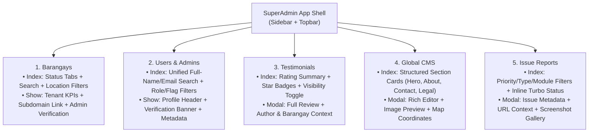

# SuperAdmin Portal Pages Redesign Plan
*(Barangays, Users, Testimonials, Global CMS, and Issue Reports)*

## 1. Executive Summary

Following the **SuperAdmin Dashboard & App Shell Redesign** ([`super_admin_dashboard_redesign_plan.md`](./super_admin_dashboard_redesign_plan.md)), this document specifies the UI/UX, functional, and backend redesign for the remaining five core modules of the SuperAdmin Portal:

1. **Barangays Management** (`/super_admin/barangays` & `/super_admin/barangays/:id`)
2. **Users & Admins Directory** (`/super_admin/users` & `/super_admin/users/:id`)
3. **Testimonials Moderation** (`/super_admin/testimonials`)
4. **Global CMS Manager** (`/super_admin/cms`)
5. **Issue Reports Triage** (`/super_admin/issue_reports`)

All pages share the **Modern Healthcare SaaS** design language (Emerald `#059669`, Teal `#0d9488`, Deep Slate `#0f172a` sidebar, soft `#f1f5f9` canvas, and elevated `#ffffff` surface cards) and a consistent page anatomy:
- **Page Header Bar:** Title, subtitle, contextual quick-stats pills, and primary action buttons.
- **Unified Filter & Search Toolbar:** Single-row responsive search bar with quick status tabs/pills and advanced filter dropdowns + "Reset" link.
- **Clean Data Surface:** Borderless horizontal-Rule tables (`sa-table`) or structured content cards with soft semantic badges, user avatars, and clear action buttons.

---

## 2. Module-by-Module Audit & Redesign Specification

---

### 2.1 Barangays Management (`/super_admin/barangays`)

#### Current Pain Points ([`barangays/index.html.erb`](../../../app/views/super_admin/barangays/index.html.erb), [`_table.html.erb`](../../../app/views/super_admin/barangays/_table.html.erb), [`show.html.erb`](../../../app/views/super_admin/barangays/show.html.erb))
1. **Missing Page Header & Summary Context:** The index page starts immediately with a search box—no page title, description, or count of *Verified vs. Unverified* barangays.
2. **N+1 Query in Table:** Calling `barangay.verified?` per row executes an `EXISTS` SQL query for every barangay in the table.
3. **Missing Key Columns:** The table does not show the barangay's **Subdomain** (`slug`), **Total Users / Residents**, or **Registration Date**, and there is no quick link to open the subdomain portal.
4. **Show Page Lacks Tenant Metrics:** `super_admin/barangays/show.html.erb` only lists Region/Province/City and Admin/Staff emails—giving the SuperAdmin no visibility into whether the barangay is actively used (e.g., count of patients, health workers, health programs, or appointments).

#### Redesign Specification
- **Index Page (`app/views/super_admin/barangays/index.html.erb`):**
  - **Header:** Title *"Registered Barangays"*, subtitle, and Segmented Status Pills: **All (`@total_count`)**, **Verified (`@verified_count`)**, **Unverified (`@unverified_count`)**.
  - **Search & Filter Toolbar:** Search by Barangay Name or City (`name_or_city_cont`), filter dropdown for **Region**, **Province**, **City**, plus a **Reset** button when filters are active.
  - **Enhanced Table Columns:**
    1. **Barangay & Subdomain:** Bold Barangay Name + clickable `<slug>.domain.com` external link badge.
    2. **Location:** `City, Province` with muted `Region` subtitle.
    3. **Primary Admin:** Admin full name & email (or *"No Admin"*).
    4. **Users:** Count badge of total users in that tenant (`users_count`).
    5. **Verification Status:** Soft Emerald badge (`Verified`) or Soft Amber badge (`Unverified`).
    6. **Actions:** **Manage / View** button (`super_admin_barangay_path(barangay)`) + quick **Verify** button if unverified.
- **Show Page (`app/views/super_admin/barangays/show.html.erb`):**
  - **Breadcrumb & Hero Header:** Barangay Name, Verification Status badge, creation date, **"Visit Subdomain Portal"** button, and **"Verify Barangay Admin"** primary emerald button (if unverified).
  - **4 Tenant Mini-KPI Cards:** *Total Patients*, *Health Workers (Admin & Staff)*, *Health Programs*, and *Total Appointments*.
  - **Two-Column Layout:**
    - **Left (`col-lg-5`):** Location & Tenant Configuration Card (Region, Province, City, Subdomain slug, Subdivision scheme: `purok`/`zone`/`both`, Created/Updated timestamps).
    - **Right (`col-lg-7`):** Admins & Health Staff Roster table with role badges, validation status badges, and links to each user's profile.

---

### 2.2 Users & Admins Directory (`/super_admin/users`)

#### Current Pain Points ([`users/index.html.erb`](../../../app/views/super_admin/users/index.html.erb), [`_search_form.html.erb`](../../../app/views/super_admin/users/_search_form.html.erb), [`show.html.erb`](../../../app/views/super_admin/users/show.html.erb))
1. **Awkward Search Form:** Splits name search into two separate inputs (*"Search First Name"* and *"Search Last Name"*) even though `User` already defines a `ransacker :full_name` in [`app/models/user.rb`](../../../app/models/user.rb#L52-L69).
2. **Missing Role Column & Role Filter:** The table does not display `user.role` (`super_admin`, `admin`, `staff`, `patient`), nor can SuperAdmin filter by Role or by `"require_validation"` status.
3. **Confusing Destructive Button Styling:** The approval action is labeled **"Remove Validation"** with `btn-danger` (red), making an approval action look like account deletion.
4. **Inconsistent Width:** Wrapped in `
` instead of fluid layout.

#### Redesign Specification
- **Index Page (`app/views/super_admin/users/index.html.erb`):**
  - **Header & Quick Filter Tabs:**
    - **All Users**, **Pending Admin Approval (`@pending_admins_count`)**, **Barangay Admins**, **Health Staff**, **Patients**.
  - **Unified Search & Filter Bar:**
    - Single search input querying `full_name_or_email_or_public_uid_cont`.
    - Role dropdown (`All Roles`, `Super Admin`, `Admin`, `Staff`, `Patient`).
    - Barangay search/select filter + Reset button.
  - **Enhanced Table Columns:**
    1. **User:** Avatar/Initials circle + Full Name + Email + `#public_uid`.
    2. **Role:** Distinct role badge (`Super Admin` Slate, `Admin` Emerald, `Staff` Sky, `Patient` Neutral).
    3. **Barangay:** Linked Barangay name & city (or *Global Platform* for SuperAdmin).
    4. **Status & Flags:** Soft Amber `Needs Validation` badge for `require_validation`; muted pills for profile flags (`no_phone_number`, `no_subdivision`).
    5. **Actions:** **Approve Admin** (`btn-emerald` with check icon) when `require_validation` is present + **View Details** button.
- **Show Page (`app/views/super_admin/users/show.html.erb`):**
  - **Action Banner (if `require_validation`):** Prominent Amber callout card at the top explaining that this Barangay Admin is awaiting verification, with a 1-click **Approve & Verify Admin** button.
  - **Profile Summary Card:** Avatar, Full Name, Role badge, Public UID, Email, Phone Number, Account Created/Updated dates, and link to their Barangay detail page & subdomain.

---

### 2.3 Testimonials Moderation (`/super_admin/testimonials`)

#### Current Pain Points ([`testimonials/index.html.erb`](../../../app/views/super_admin/testimonials/index.html.erb), [`TestimonialsController`](../../../app/controllers/super_admin/testimonials_controller.rb))
1. **No Moderation Action (`visible` / `hidden`):** `Testimonial` has `enum :status, [:hidden, :visible]`, yet SuperAdmin has no button or controller action to toggle whether a testimonial is displayed on the public landing page!
2. **Missing Barangay Context:** Doesn't show which Barangay the reviewer represents.
3. **Plain Integer Rating:** Renders `4` instead of visual star icons (`★★★★☆`).

#### Redesign Specification
- **Header & Summary Strip:**
  - Shows **Total Testimonials**, **Average Rating (`4.8 ★`)**, and **Visible on Landing Page** count.
- **Search & Filter Toolbar:**
  - Search by Reviewer Name or Email, filter by **Star Rating (`1★..5★`)**, **Visibility Status (`Visible` / `Hidden`)**, and **Date (`All Time`, `This Year`, `Last Year`)**.
- **Table & Modal Improvements:**
  - Columns: **Reviewer & Barangay**, **Testimonial Excerpt**, **Star Rating** (gold `bi-star-fill` icons + score), **Visibility Status** (`Visible` / `Hidden` badge), **Submitted Date**, and **Actions** (**View Modal** + **Toggle Visibility** button `PATCH toggle_status_super_admin_testimonial_path` if added, or status indicator).
  - **Redesigned Testimonial Modal:** Clean quote card layout showing full testimonial text, star rating, reviewer profile info, barangay badge, and submission timestamp.

---

### 2.4 Global CMS Manager (`/super_admin/cms`)

#### Current Pain Points ([`cms/index.html.erb`](../../../app/views/super_admin/cms/index.html.erb), [`_form_modal.html.erb`](../../../app/views/super_admin/cms/_form_modal.html.erb))
1. **Cramped `18rem` Cards with Broken Placeholders:** All 5 global pages (*Homepage Hero Banner*, *About Us*, *Contact Us*, *Privacy Policy*, *Terms of Use*) render as `18rem` image cards—even though only *Homepage Hero Banner* uses an image attachment, causing 4 out of 5 cards to display a huge ugly `"Image Not Applicable"` placeholder graphic.
2. **No Content Preview or Last Updated Timestamp:** Cards only show `Title` and `Subheadline` without showing `updated_at` or a snippet of the rich-text body.

#### Redesign Specification
- **Header Bar:** Title *"Global Content Management (Main Portal)"*, explaining that changes update the main domain (`root_path`, `/about_us`, `/contact_us`, `/privacy_policy`, `/terms_of_use`) and notify verified Barangay Admins.
- **Structured CMS Section Grid (`row g-4`):**
  - **Featured Card (`col-12`): Homepage Hero Banner** — Wide split card showing the live hero banner image preview on the left and the Headline, Subheadline, last updated timestamp, **Preview Live Page**, and **Edit Section** button on the right.
  - **Content & Legal Pages Grid (`col-md-6`):** Clean document-style cards for **About Us**, **Contact Us** (displaying map pin coordinates badge), **Privacy Policy**, and **Terms of Use** with section icon wells (`bi-info-circle`, `bi-geo-alt`, `bi-shield-lock`, `bi-file-earmark-text`), rich-text excerpt preview, last updated timestamp, **View Live** link, and **Edit Content** modal trigger.
- **Polished Edit Modal (`_form_modal.html.erb`):**
  - Styled header with section badge, clean form spacing, Trix rich-text area container, current image thumbnail preview (for Hero Banner), and clear Latitude/Longitude coordinate inputs (for Contact Us).

---

### 2.5 Issue Reports Triage (`/super_admin/issue_reports`)

#### Current Pain Points ([`issue_reports/index.html.erb`](../../../app/views/super_admin/issue_reports/index.html.erb), [`_view_modal.html.erb`](../../../app/views/super_admin/issue_reports/_view_modal.html.erb), [`_status_update_form.html.erb`](../../../app/views/super_admin/issue_reports/_status_update_form.html.erb))
1. **Minimal Filtering:** Only provides a single `status_eq` select dropdown; cannot search by keyword/UID/email or filter by `priority` (`critical`, `high`, `medium`, `low`) or `issue_type` (`bug`, `feature_request`, `ui_ux`, `security`).
2. **Default Ordering:** Does not order by `created_at DESC` or priority.
3. **Copy-Paste Typo in Status Form:** `_status_update_form.html.erb` has `prompt: "Select a audience"` instead of `"Select Status"`.
4. **Cluttered View Modal:** `_view_modal.html.erb` misses the `module_area` and `url` fields from `IssueReport` and renders a huge dark `bg-secondary` box even when no screenshots are attached.

#### Redesign Specification
- **Header & Status Summary Strip:**
  - Quick status filter pills: **All Reports**, **Open**, **In Progress**, **Resolved**, **Closed**, plus a count badge for **Critical / High Priority**.
- **Comprehensive Filter Toolbar:**
  - Search input (`title_or_email_or_public_uid_cont`), **Priority** select, **Issue Type** select, **Module Area** select, and **Status** select.
- **Enhanced Table (`sa-table`):**
  - Columns: **Ticket `#public_uid`**, **Issue Title & Module Area**, **Type**, **Priority**, **Status (with inline Turbo dropdown updater)**, **Reporter & Date**, and **Inspect Modal** button.
- **Redesigned Issue Inspection Modal (`_view_modal.html.erb`):**
  - Header with Ticket `#public_uid` and Priority/Type/Status badges.
  - Metadata grid showing **Module Area**, **Affected URL** (clickable if present), **Reporter Email**, and **Timestamp**.
  - Clean Description panel.
  - Screenshot gallery carousel (or a compact *"No screenshots attached"* empty state instead of a bulky placeholder image).
  - Inline status update footer directly inside the modal as well as in the table row.

---

## 3. Implementation File Matrix

| Module | Files to Modify / Create | Key Improvements |
| :--- | :--- | :--- |
| **1. Barangays** | `app/controllers/super_admin/barangays_controller.rb` `app/views/super_admin/barangays/index.html.erb` `app/views/super_admin/barangays/_search_form.html.erb` `app/views/super_admin/barangays/_table.html.erb` `app/views/super_admin/barangays/show.html.erb` | - Preload verified status & user counts to eliminate N+1 queries. - Add Status tabs, Subdomain column, and Tenant KPI cards on `show`. |
| **2. Users** | `app/controllers/super_admin/users_controller.rb` `app/views/super_admin/users/index.html.erb` `app/views/super_admin/users/_search_form.html.erb` `app/views/super_admin/users/show.html.erb` | - Unified `full_name_or_email_cont` search + Role & Validation filters. - Add Role column, rename `"Remove Validation"` → `"Approve Admin"` (`btn-emerald`). - Redesign User profile show view with verification banner. |
| **3. Testimonials** | `app/controllers/super_admin/testimonials_controller.rb` `app/views/super_admin/testimonials/index.html.erb` `app/views/super_admin/testimonials/_search_form.html.erb` `app/views/super_admin/testimonials/_testimonial_modal.html.erb` | - Eager-load `:barangay` and run inside `ActsAsTenant.without_tenant`. - Render visual star ratings, Barangay badge, and summary metrics. |
| **4. Global CMS** | `app/views/super_admin/cms/index.html.erb` `app/views/super_admin/cms/_form_modal.html.erb` | - Replace `18rem` placeholder cards with featured Hero Banner card + structured Document cards. - Polish modal form layout. |
| **5. Issue Reports** | `app/controllers/super_admin/issue_reports_controller.rb` `app/views/super_admin/issue_reports/index.html.erb` `app/views/super_admin/issue_reports/_status_update_form.html.erb` `app/views/super_admin/issue_reports/_view_modal.html.erb` | - Order by newest, add Priority/Type/Module/Keyword filters. - Fix `"Select a audience"` typo. - Display `module_area` & `url` in view modal and clean up empty screenshot state. |

---

## 4. Interactive All-Pages Prototype

A complete, interactive HTML prototype containing allRedesigned SuperAdmin pages (**Barangays List & Detail View**, **Users List & Profile View**, **Issue Reports & Triage Modal**, **Testimonials & Review Modal**, and **Global CMS & Editor Modal**) is saved at:
- [`doc/design/super_admin_pages_prototype.html`](./super_admin_pages_prototype.html)
