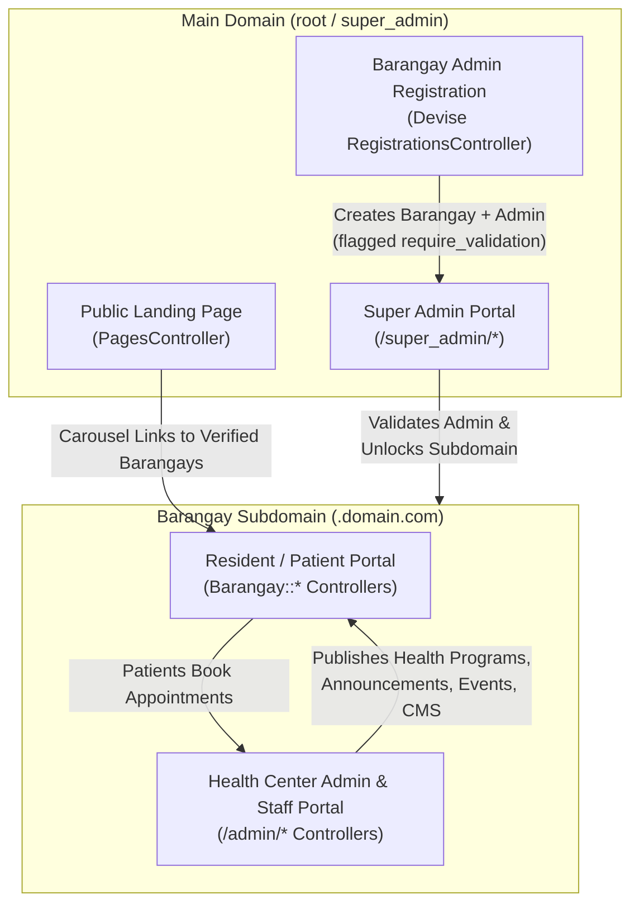

# Full Project Review: Barangay Health Center Management System (`brgy_health`)

## 1. Executive Summary & Project Purpose

**`brgy_health`** is a **multi-tenant, cloud-based Barangay Health Center Management System and Community Health Portal** built on **Ruby on Rails 8**.

In the Philippines, the *Barangay Health Center (BHC)* serves as the primary grassroots healthcare unit—delivering basic medical consultations, maternal and child care, immunizations, TB-DOTS, and health education. However, most barangay health centers operate on paper-based logbooks, manual queues, and physical bulletin boards.

**The purpose of this project** is to provide a **Software-as-a-Service (SaaS) platform** where any Barangay in the Philippines can register, get verified, and immediately receive its own dedicated **subdomain portal** (e.g., `bagong-buhay.domain.com`) complete with a customizable Content Management System (CMS), health program and event publishing, online patient appointment scheduling, automated multi-channel reminders, electronic medical visit tracking, and printable PDF reports.

---

## 2. Core Problems Solved

### 1. Lack of Digital Presence for Local Barangays
* **The Problem:** Individual barangays lack the technical resources or budget to build, host, and maintain their own healthcare portals.
* **How `brgy_health` Solves It:**
  * Uses **subdomain-based multi-tenancy** via `acts_as_tenant` (`ApplicationController#set_current_tenant` and `Constraints::SubdomainConstraint`).
  * When a Barangay Admin signs up on the main domain (`Users::RegistrationsController#create`), a `Barangay` record is created with a unique slug/subdomain, and `BarangayGeneratePagesJob` automatically provisions default CMS pages (*Hero Banner, About Us, Contact Us* with interactive Leaflet maps).
  * A **Super Admin verification gate** (`BarangayController#check_admin_flags`) ensures unverified barangay portals remain inaccessible (`404`) until vetted and approved by the platform Super Admin (`SuperAdmin::UsersController#validated`).

### 2. Long Queues, Overcrowding, and Chaotic Walk-In Scheduling
* **The Problem:** Residents often line up at dawn for limited-slot health services (e.g., free check-ups, vaccination drives, prenatal care) without knowing slot availability or operating hours.
* **How `brgy_health` Solves It:**
  * **Structured Service Windows (`Announcement`):** Health workers publish specific service announcements tied to a `HealthProgram`, defining `start_date`, `end_date`, daily `open_time`/`close_time`, target `audience`, and `max_patients` capacity.
  * **Online Booking & Capacity Control (`Appointment`):** Residents book appointments within the announcement's valid date range (`scheduled_at_within_announcement_range`).
  * **Approval, Waitlisting & Follow-ups (`Admin::AppointmentsController`):** Health workers review pending bookings, approve or reject them, reschedule with reasons, and schedule chained **follow-up check-ups** (`follow_up_id` self-referential association). If an announcement reaches full capacity (`max_patients`), additional approved appointments are automatically tagged as `"waitlisted"`.

### 3. Missed Appointments & Poor Community Information Dissemination
* **The Problem:** Patients forget scheduled check-ups or miss community-wide health events (e.g., dengue awareness, senior citizen immunization) because announcements are only posted physically at the barangay hall.
* **How `brgy_health` Solves It:**
  * **Multi-Channel Real-Time Notifications (`Noticed` gem):** Delivers notifications via three channels:
    1. **In-App Live Broadcasts** over Action Cable / Turbo Streams (`DeliveryMethods::NotificationBroadcast`).
    2. **Browser / Mobile PWA Web Push Notifications** (`DeliveryMethods::WebPush` & `PushSubscription`).
    3. **Transactional Emails** (`UserMailer`).
  * **Progressive Countdown Reminders (`AppointmentReminderJob`):** Automatically chains reminders at **24 hours**, **60 minutes**, **30 minutes**, and **5 minutes** before an appointment (`appointment_reminder_job_wait_until_condition`), plus a daily 7:00 AM batch reminder (`AppointmentsReminderJob`) and a 6:00 PM missed-appointment sweep (`AppointmentsMissedJob`) configured in `config/recurring.yml`.
  * **Targeted Community Events (`Event`):** Publishes events targeted at specific demographics (`senior_citizens`, `pregnant_women`, `children`, `pwds`, `mothers`, etc.) and immediately notifies registered patients.

### 4. Fragmented Patient Records & Administrative Reporting Overhead
* **The Problem:** Retrieving a resident's consultation history or compiling attendance reports for LGU/DOH audits is tedious when stored in physical folders.
* **How `brgy_health` Solves It:**
  * **Consultation Notes & Medical History:** Entering clinical notes on an approved appointment automatically transitions its status to `completed` (`Appointment#completed_appointment`), building a longitudinal medical history viewable per patient (`Admin::UsersController#medical_records`).
  * **SQL View & PDF Reporting:** Uses the `scenic` gem to maintain a denormalized PostgreSQL view (`db/views/appointment_reports_v01.sql` / `AppointmentReport`) and exports formatted A4 landscape PDF reports via `Grover` (Puppeteer) in `Admin::AppointmentReportsController#index`.
  * **Visual Dashboards:** Provides real-time KPIs and charts (`Chartkick` + `Groupdate`) for both Barangay Admins (`Admin::DashboardController`) and Super Admins (`SuperAdmin::DashboardController`).

---

## 3. System Architecture & User Roles

### Role Hierarchy (`User`)
| Role | Scope | Key Responsibilities |
| :--- | :--- | :--- |
| **`super_admin`** | Global (Main Domain only) | Validates new Barangay Admin registrations, oversees all registered Barangays, manages global CMS pages (*Terms of Use, Privacy Policy, Main Hero*), moderates Testimonials, and triages platform `IssueReport` tickets. |
| **`admin`** | Tenant (`Barangay`) | Registers the Barangay, manages Barangay CMS pages, creates `Staff` accounts, manages `HealthProgram`s, `Announcement`s, `Event`s, `Appointment`s, generates PDF reports, and submits platform `Testimonial`s. |
| **`staff`** | Tenant (`Barangay`) | Barangay Health Workers (BHWs), nurses, or midwives who co-manage announcements, events, appointments, consultation notes, and patient records under `/admin`. |
| **`patient`** | Tenant (`Barangay`) | Barangay residents (organized by `Subdivision` — Purok/Zone) who sign up on their barangay's subdomain, browse announcements/events, book/cancel/reschedule appointments, and receive health notifications. |

---

## 4. Technical Stack Overview

* **Framework:** Ruby 3.3.6 / Rails 8.0.2
* **Database:** PostgreSQL (`pg`) + `scenic` (SQL views) + `data_migrate` (data migrations in `db/data/`)
* **Rails 8 "Solid Trifecta":** `solid_queue` (background jobs & recurring schedules), `solid_cache`, `solid_cable`
* **Frontend:** Hotwire (`turbo-rails`, `stimulus-rails`), Bootstrap 5 (`cssbundling-rails` + Sass), `jsbundling-rails`, ViewComponent, Action Text (Trix editor), Leaflet.js (maps), Splide.js
* **Authentication & Multi-Tenancy:** `devise`, `acts_as_tenant`, `friendly_id`, `public_uid`
* **Search, Pagination & Tagging:** `ransack`, `pagy`, `acts-as-taggable-on`
* **Notifications & Reporting:** `noticed` (v2), `web-push`, `grover` (HTML-to-PDF), `chartkick` + `groupdate`
* **Testing:** RSpec (`rspec-rails`, `factory_bot_rails`, `shoulda-matchers`, `capybara`)

---

## 5. Bugs Found & Resolved

During the full project run-through, the following bugs, runtime errors, and security issues were identified and resolved:

### 1. RSpec Tenancy Setup Breaking Fixture Associations (`spec/spec_helper.rb`)
* **Bug:** `$default_barangay` was created in `before(:suite)` before RSpec's `global_fixtures = :all` wiped and reloaded the `barangays` table with fixture IDs (`1..4`). This left `ActsAsTenant.current_tenant` pointing to a stale, non-existent `barangay_id`, causing `Appointment#scheduled_at_within_announcement_range` to raise `NoMethodError: undefined method 'start_date' for nil` in `spec/models/appointment_spec.rb:80`.
* **Fix:** Resolved `default_barangay` inside `before(:each)` after fixtures are loaded (`Barangay.find_by(id: 1) || Barangay.find_or_create_by!(...)`) and added a nil-guard in `Appointment#scheduled_at_within_announcement_range`.

### 2. Reschedule Tag Name Mismatch in `Appointment` (`app/models/appointment.rb`)
* **Bug:** `Appointment` validated `:reschedule_reason` presence only when `flag_list.include?("reschedule")`, whereas `Admin::AppointmentsController#flag_as_reschedule` and `Barangay::AppointmentsController#flag_as_reschedule` added `"rescheduled"`, bypassing the validation.
* **Fix:** Updated validation condition to check `self.flag_list.include?("rescheduled") || self.flag_list.include?("reschedule")`.

### 3. Mailer & Notifier Argument/Broadcast Bugs
* **`Testimonial#send_new_testimonial_notification` (`app/models/testimonial.rb`):** Removed the broken `UserMailer.new_testimonial_email(self, super_admins.first).deliver_later` call (which passed 2 arguments to a 1-argument method and duplicated `NewTestimonialNotifier`'s email delivery) and passed `record: self` to `NewTestimonialNotifier`.
* **`NewTestimonialNotifier` & `UserCredentialChangedNotifier`:** Added `config.args = -> { [ self ] }` to `deliver_by :email` so `UserMailer#new_testimonial_email(notification)` and `UserMailer#credential_changed(notification)` receive the notification instance, and passed `record: self` in `User#notify_user_of_credential_change`.
* **`app/views/user_mailer/credential_changed.html.erb`:** Changed `@changed_attributes.each do |attr|` (which yielded `[key, value]` arrays and crashed on `attr.humanize`) to `@changed_attributes.each_key do |attr|`.
* **`DeliveryMethods::NotificationBroadcast` (`app/notifiers/delivery_methods/notification_broadcast.rb`):** Added fallback `broadcaster = record || recipient` and corrected the broadcast target ID from `"notification_status"` to `"notification_status_frame"`.

### 4. Controller Bugs & Security Fixes
* **`Admin::HealthProgramsController#update` (`app/controllers/admin/health_programs_controller.rb`):** Fixed `NameError` in `location: [ admin, @admin_health_program ]` → `location: [ :admin, @admin_health_program ]`.
* **`SuperAdmin::TestimonialsController#index` (`app/controllers/super_admin/testimonials_controller.rb`):** Fixed `PG::UndefinedColumn: ERROR: column users.full_name does not exist` by querying `CONCAT_WS(' ', users.first_name, users.middle_name, users.last_name, users.suffix) ILIKE ?`.
* **`Admin::UsersController` (`app/controllers/admin/users_controller.rb`):** Removed redundant `@user = User.find(params[:id])` in `toggle_status` (which broke when `public_uid` was passed) and prevented non-super-admins from escalating a user's `:role` to `"super_admin"`.
* **`ProfileController#update` (`app/controllers/profile_controller.rb`) & `_address_form.html.erb`:** Passed `@user` to `edit_profile_path(@user)` and `profile_path(@user.id)` to prevent `ActionController::UrlGenerationError`, and added `status: :unprocessable_entity` on failed updates.
* **`Admin::TestimonialsController#create` (`app/controllers/admin/testimonials_controller.rb`):** Removed `render :new` (no `new` template exists; handled via `create.turbo_stream.erb`).
* **`Users::RegistrationsController#create` & `_main_form.html.erb`:** Ensured `resource.build_barangay` is re-initialized on failed sign-up and added safe navigation (`resource.barangay&.region`) in `_main_form.html.erb`.

### 5. Background Jobs, Views, Helpers & Stimulus Fixes
* **`BarangayGeneratePagesJob` (`app/jobs/barangay_generate_pages_job.rb`):** Fixed invalid default `latitude: 120.9842` to `14.5995`.
* **Recurring Jobs (`AppointmentsReminderJob`, `AppointmentsMissedJob`, `AnnouncementCompletedJob`, `EventCompletedJob`):** Wrapped queries in `ActsAsTenant.without_tenant` so records across all barangays are processed.
* **Duplicate Code Cleanup:** Removed duplicate `ransackable_associations` in `User`, duplicate `belongs_to :health_program` in `Announcement`, duplicate `validates` in `HealthProgram`, and duplicate `resources :testimonials` in `config/routes.rb`.
* **`Barangay::AppointmentsHelper#display_resceduled_button?`:** Used the passed `appointment` argument (`appointment || @appointment`).
* **View & Turbo Stream Fixes:**
  * Replaced hardcoded `"Community Health Fair"` title with `<%= @announcement.name %>` and guarded optional `@announcement.health_program&.name` in `app/views/admin/announcements/show.html.erb` and `app/views/barangay/announcements/_announcement.html.erb`.
  * Fixed patient "View Previous Appointment" link in `app/views/barangay/appointments/show.html.erb` (`appointment_path` instead of `admin_appointment_path`).
  * Implemented missing `app/views/notifications/mark_all_as_read.turbo_stream.erb` and fixed frame ID `dom_id(@issue_report, "status_form")` in `app/views/super_admin/issue_reports/status_update.turbo_stream.erb`.
  * Added safe navigation for missing admin/hero banner attachments in `app/views/shared/_footer.html.erb`, `app/views/pages/home.html.erb`, and `app/views/barangay/pages/home.html.erb`.
  * Fixed `Splide` target check (`this.hasMainSlidesTarget`) and removed uninitialized `splide.mount()` call in `app/javascript/controllers/splide_loader_controller.js`.
